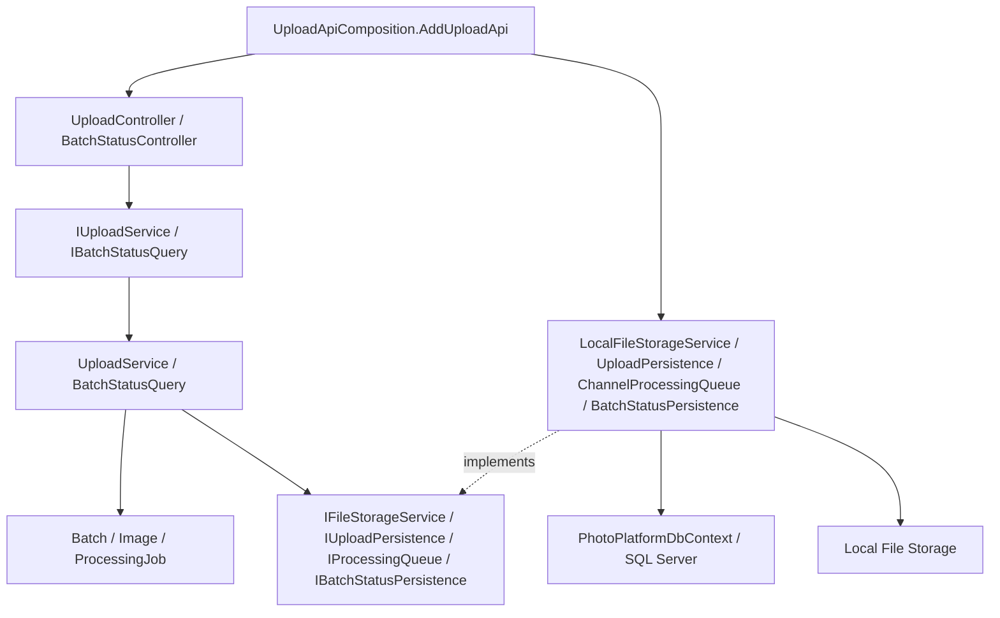
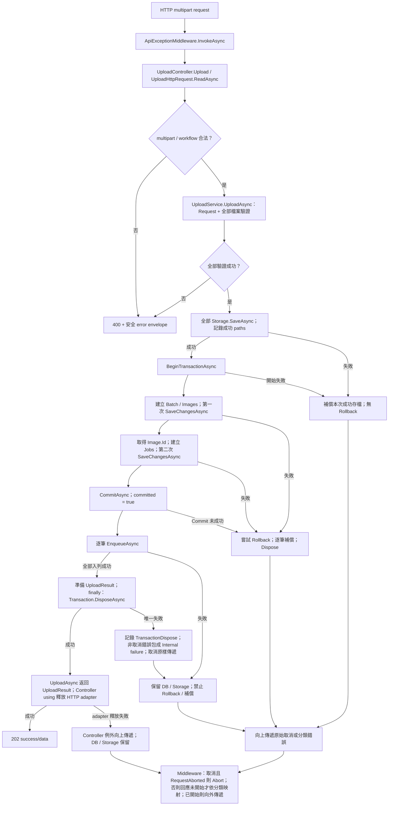
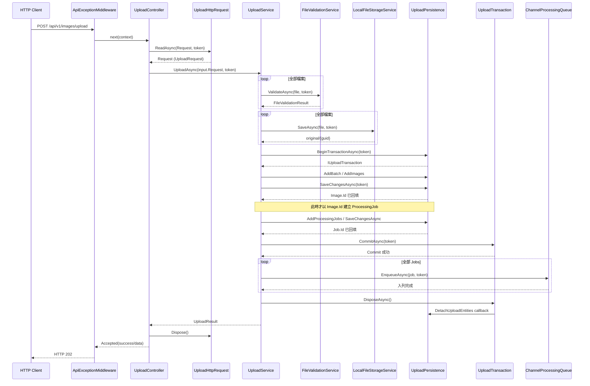
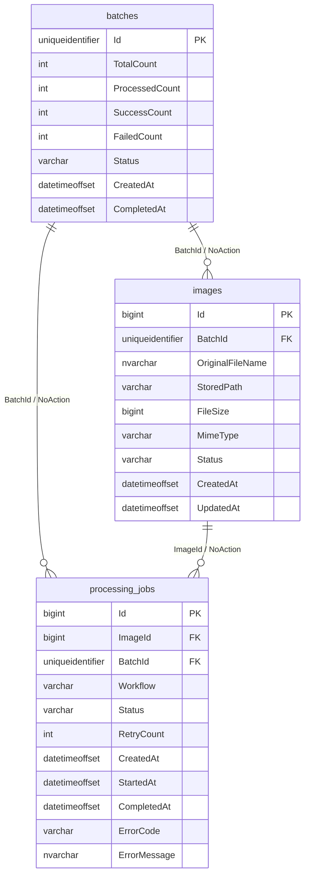
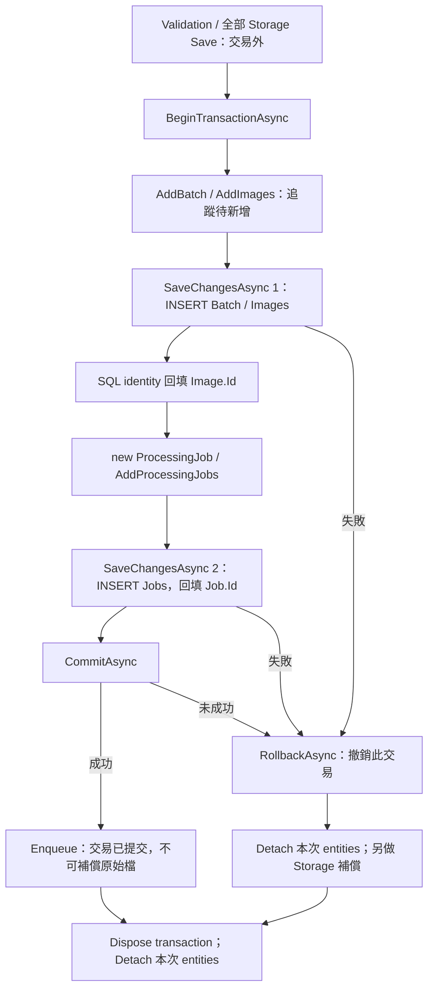
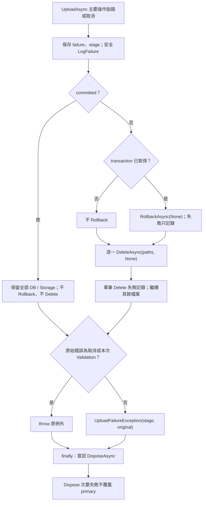
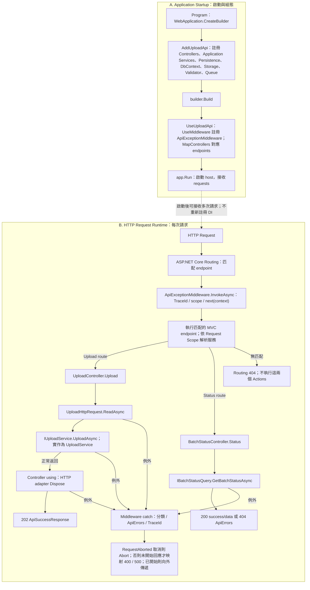
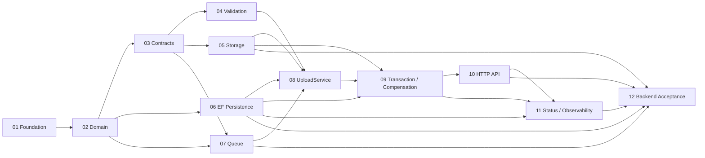

# MOD-01 Upload：技術手冊與程式碼閱讀指南

本文件說明圖片如何被接收、驗證、保存，以及如何建立可交給後續模組的工作。適合有 Python 經驗、正在學習本專案 C# 程式的讀者，也提供架構與可靠性設計的程式碼佐證。

**實作基準：** `feature/mod-01-upload`，HEAD `a1bb29e1d7cf704a202adbe1c14741b6441575be`（`chore(vscode): set default solution`）。撰寫前工作樹乾淨，本文件原先不存在。所有「目前實作」指此基準，不代表其他分支或後續版本。

本次為文件盤點，沒有重新執行 restore、build 或 tests。因此，下文「測試驗證」指既有測試的情境與斷言，不能解讀為本次執行通過。TASK 文件的核取方塊也不作為目前功能是否存在的唯一證據。

## 目錄

1. [MOD-01 模組總覽](#chapter-1)
2. [Clean Architecture 系統架構](#chapter-2)
3. [完整 Upload 運作流程](#chapter-3)
4. [TASK-01～TASK-12 完整實作解析](#chapter-4)
   - [TASK-01 Project Foundation](#task-01)
   - [TASK-02 Upload Domain Model](#task-02)
   - [TASK-03 Upload Application Contracts](#task-03)
   - [TASK-04 File Validation](#task-04)
   - [TASK-05 Local File Storage Implementation](#task-05)
   - [TASK-06 EF Core Persistence](#task-06)
   - [TASK-07 Processing Queue](#task-07)
   - [TASK-08 Upload Application Service](#task-08)
   - [TASK-09 Transaction & Compensation](#task-09)
   - [TASK-10 Upload API](#task-10)
   - [TASK-11 Batch Status & Observability](#task-11)
   - [TASK-12 Integration, E2E & MOD-01 Backend Acceptance](#task-12)
5. [C# 與 .NET 核心語法導覽](#chapter-5)
6. [EF Core、SQL Server 與資料庫設計](#chapter-6)
7. [錯誤處理、Rollback 與 Compensation](#chapter-7)
8. [API、Middleware 與 HTTP Request Pipeline](#chapter-8)
9. [Batch Status 與 Observability](#chapter-9)
10. [TASK 相依關係](#chapter-10)
11. [原始碼閱讀地圖](#chapter-11)
12. [MOD-01 與 MOD-02 的模組交接](#chapter-12)
13. [來源、品質檢查與待確認事項](#document-review)

<a id="chapter-1"></a>
## Chapter 1 — MOD-01 模組總覽

把 Upload 想成照片處理平台的收件窗口：它先確認這批照片符合接收條件，保存原始內容，再替每張照片建立工作單。收件完成會回傳批次編號，方便稍後查詢。

使用者送出 `multipart/form-data`，以 `files` 傳一張或多張圖，以 `workflow` 指定 `Naming`、`Analysis`、`DuplicateDetection` 或 `Full`。正常結果為 HTTP `202 Accepted`：必要存檔、資料庫提交及所有 Job 入列已完成，呼叫端取得 `batchId`、`totalCount`、`status`。這時狀態仍是 `Pending`，不表示 EXIF、分析或命名已完成。

| 核心能力 | 使用者得到什麼 | 責任界線 |
|---|---|---|
| 單張／多張上傳 | 同一 Request 對應一個 Batch | Commit 前整個 Request 一起成功或失敗 |
| 檔案驗證 | 拒絕不支援格式、不合法檔名與錯誤 signature | 只檢查基本 signature，不保證完整圖片可解碼 |
| 原始檔保存 | 保存完整 bytes 與 logical storage key | SQL 不存圖片 binary |
| Batch／Image／Job | SQL Server 有可持續查詢的資料 | 不在 Upload 執行影像分析 |
| Queue enqueue | 將已提交的 Job 傳入 runtime Channel | Queue 不提供持久化保證 |
| Batch Status | 查詢持久化計數、狀態及進度 | 不自行推進 Processing lifecycle |
| 安全錯誤與追蹤 | error code、固定訊息、TraceId | 不回傳原始 SQL／路徑／stack |

兩個成功界線需要分開：**Commit 成功**表示 DB 接受資料，原始圖片不得再因 Queue 失敗而刪除；**UploadAsync 正常完成並回傳 202**還需要所有 enqueue 及方法離開時的必要資源釋放完成。Queue 或 Transaction Dispose 在 Commit 後失敗，HTTP 可能仍是 500，但資料已存在。

MOD-01 的工作在「保存並交付工作、提供查詢」結束。MOD-02 負責 Worker、Workflow 協調、狀態、Retry、Recovery 與並行控制；真正的 Metadata、Duplicate、Similarity、Quality、Naming 各有自己的模組。本基準沒有 Worker，不能展示圖片分析完成的結果。

<a id="chapter-2"></a>
## Chapter 2 — Clean Architecture 系統架構

### 四層如何合作

| Layer | 接收資料與主要元件 | 呼叫對象／輸出 | 為什麼放在這層 |
|---|---|---|---|
| API | HTTP、`UploadController`、`UploadHttpRequest`、`FormUploadFile`、`ApiExceptionMiddleware`、`BatchStatusController` | 呼叫 Application interfaces，回傳 envelope | multipart、status code 與 TraceIdentifier 屬於 HTTP |
| Application | `UploadRequest`、`UploadService`、`FileValidationService`、`BatchStatusQuery`、DTOs、interfaces | 建立 Domain entities；經 interface 存檔、持久化及入列 | 決定操作順序與失敗界線，不綁定 SQL／本機檔案／HTTP |
| Domain | `Batch`、`Image`、`ProcessingJob`、`WorkflowType`、`ProcessingJobStatus` | 形成批次、圖片、工作與初始狀態 | 模型不必知道資料怎麼存，也不依賴 EF Core |
| Infrastructure | `UploadPersistence`、`UploadTransaction`、`PhotoPlatformDbContext`、Configurations、`LocalFileStorageService`、`ChannelProcessingQueue`、`BatchStatusPersistence` | SQL Server、檔案系統、Channel | 把 Application 要求的能力落實成具體 I/O |

### 圖 1：Clean Architecture 與組合根



實線表示使用關係；虛線表示實作介面。執行時 `UploadService` 的呼叫會到 Infrastructure instance，但編譯時 Application 只引用 interface。`UploadApiComposition` 是 API 的組合根，因此 API project 額外引用 Infrastructure 來註冊實作，不等於 Controller 可以直接操作 DB。

### Class／Interface 責任對照

| 抽象／模型 | 具體合作對象 | 誰使用、解決什麼問題 |
|---|---|---|
| [IUploadService](../../src/PhotoPlatform.Application/Interfaces/IUploadService.cs) | [UploadService](../../src/PhotoPlatform.Application/Services/UploadService.cs) | Controller 啟動一次 Upload use case |
| [IUploadFile](../../src/PhotoPlatform.Application/Interfaces/IUploadFile.cs) | [FormUploadFile](../../src/PhotoPlatform.Api/Http/FormUploadFile.cs) | Validator／Storage 借用資料與 Stream，免依賴 IFormFile |
| [IFileValidationService](../../src/PhotoPlatform.Application/Interfaces/IFileValidationService.cs) | [FileValidationService](../../src/PhotoPlatform.Application/Services/FileValidationService.cs) | UploadService 先確認所有檔案可接收 |
| [IFileStorageService](../../src/PhotoPlatform.Application/Interfaces/IFileStorageService.cs) | [LocalFileStorageService](../../src/PhotoPlatform.Infrastructure/Storage/LocalFileStorageService.cs) | 保存與補償刪除；Application 不組合實體路徑 |
| [IUploadPersistence](../../src/PhotoPlatform.Application/Interfaces/IUploadPersistence.cs) | [UploadPersistence](../../src/PhotoPlatform.Infrastructure/Persistence/UploadPersistence.cs) | 登記 entities、Save、開啟交易 |
| [IUploadTransaction](../../src/PhotoPlatform.Application/Interfaces/IUploadTransaction.cs) | [UploadTransaction](../../src/PhotoPlatform.Infrastructure/Persistence/UploadTransaction.cs) | 將 EF transaction 藏在 Infrastructure |
| [IProcessingQueue](../../src/PhotoPlatform.Application/Interfaces/IProcessingQueue.cs) | [ChannelProcessingQueue](../../src/PhotoPlatform.Infrastructure/Processing/ChannelProcessingQueue.cs) | 傳遞已提交的 ProcessingJob，不執行分析 |
| [IBatchStatusQuery](../../src/PhotoPlatform.Application/Interfaces/IBatchStatusQuery.cs) | [BatchStatusQuery](../../src/PhotoPlatform.Application/Services/BatchStatusQuery.cs) | API 取得完成進度計算的結果 |
| [IBatchStatusPersistence](../../src/PhotoPlatform.Application/Interfaces/IBatchStatusPersistence.cs) | [BatchStatusPersistence](../../src/PhotoPlatform.Infrastructure/Persistence/BatchStatusPersistence.cs) | 只投影 Batch aggregate，不回傳 EF entity |

沒有這些界線時，Controller 很容易同時決定交易、刪檔與 Queue 時機，測一個失敗分支也必須啟動所有 I/O。目前 Unit Tests 能用替身觀察操作順序，真正 SQL、HTTP、檔案則由 Integration Tests 驗證。

### DI lifetime 也是隔離設計

[AddUploadApi](../../src/PhotoPlatform.Api/UploadApiComposition.cs) 把 UploadService、Query、Persistence 與 DbContext 設為 Scoped；每個 HTTP Request 有自己的 tracking／transaction。Storage、Validator 與 Queue 是 Singleton：前兩者不保存 Request 專屬狀態，Queue 則需要讓所有 Producer 與未來 Consumer 共用。測試用 decorator 可改成 Scoped，但不代表 production registration 改變。

<a id="chapter-3"></a>
## Chapter 3 — 完整 Upload 運作流程

### 圖 2：Upload 完整 Flowchart



先驗證全部檔案，再存全部檔案，避免驗證到最後一張才發現前面已產生副作用。SQL transaction 只包兩次 Save 與 Commit。圖中的一般失敗分支需要經 finally 釋放資源；Cancellation 同樣遵守 Commit 邊界，並不一律回傳 500。

Queue 全部成功後，return 會先準備 UploadResult，再執行 UploadService.finally 的 Transaction.DisposeAsync；其內先嘗試釋放 EF transaction，再於 finally 呼叫 DetachUploadEntities。只有這段清理成功，UploadAsync 才正常返回結果。若 Dispose 是唯一失敗，非取消例外包為 Internal／TransactionDispose，OperationCanceledException 原樣傳遞；它不重新進入主流程 catch，也不執行 Rollback 或 Storage Compensation。此時 committed 已是 true，即使 HTTP 最後映射 500，Batch／Images／Jobs 與原始檔仍保留。

Controller 隨後在自己的 using 離開時釋放 HTTP adapter，這是另一個生命週期；其清理仍可能失敗，不能和 Transaction Dispose 合併。圖中 400 表示既定 validation failure；其他例外交 middleware 依分類映射（StorageSave 為 500／STORAGE_ERROR，Internal 為 500／INTERNAL_ERROR）。取消且 RequestAborted 已取消會 Abort；回應已開始的其他例外繼續向外傳遞，未開始才嘗試寫 error envelope，不保證中斷的連線收到回應。

### 呼叫者、輸入、輸出與失敗點

| 步驟 | Class.Method／呼叫者 | 輸入 → 執行 → 輸出 | 原因與失敗處理 |
|---|---|---|---|
| 1 | `ApiExceptionMiddleware.InvokeAsync`，由 ASP.NET Core pipeline 呼叫 | HttpContext → 保證 TraceIdentifier、建立 logging scope → `next(context)` | 讓後續 error.traceId 可對照 log；回應開始後不改寫 envelope |
| 2 | `UploadController.Upload` → `UploadHttpRequest.ReadAsync` | HttpRequest + token → 解析 multipart／單一 workflow／files → `UploadHttpRequest.Request` | HTTP 型別留在 API；無效格式為 INVALID_FILE，非法 workflow 為 INVALID_WORKFLOW |
| 3 | `UploadService.UploadAsync`，由 Controller 經 IUploadService 呼叫 | UploadRequest → 固定 Files 陣列、檢查至少一檔與 enum → 可驗證清單 | 空集合 400；尚無 Storage／DB side effect |
| 4 | `FileValidationService.ValidateAsync`，由 UploadService 逐檔呼叫 | IUploadFile + token → 檔名、extension、size、MIME、signature → FileValidationResult | 任一無效立即整批停止，轉 UploadValidationException；不做 decode |
| 5 | `LocalFileStorageService.SaveAsync`，由 UploadService 經 interface 呼叫 | IUploadFile → 從頭複製 bytes → `original/{guid}` | 成功才加入 paths；本次 Save 的 partial file 由 Storage 自行清理 |
| 6 | `UploadPersistence.BeginTransactionAsync`，由 UploadService 呼叫 | token → EF Database.BeginTransactionAsync → IUploadTransaction | 存檔後才開 SQL transaction；開始失敗只補償 Storage |
| 7 | `Batch`／`Image` constructors，UploadService 建立 | GUID／檔案資訊／paths／時間 → Pending entities | 一個 Batch 與 N 個 Images；此時尚未 INSERT，Image.Id 為 0 |
| 8 | `UploadPersistence.AddBatch/AddImages/SaveChangesAsync` | entities → EF tracking → SQL INSERT、回填 Image.Id | 第一次 Save 取得真實 identity；失敗 Rollback + 補償 |
| 9 | `ProcessingJob` constructor，再 `AddProcessingJobs/SaveChangesAsync` | 真實 Image.Id + BatchId + Workflow → Pending Jobs、回填 Job.Id | 第二次 Save；Job 必須關聯到已存在於此交易的 Image |
| 10 | `UploadTransaction.CommitAsync`，由 UploadService 呼叫 | token → EF transaction commit → 成功後 committed=true | await 成功才跨界；後續不得因 Queue／取消刪檔 |
| 11 | `ChannelProcessingQueue.EnqueueAsync`，UploadService 逐 Job 呼叫 | ProcessingJob + token → bounded Channel WriteAsync → Task 完成 | Worker 未來只能收到已提交 Job；滿載等待，失敗不補償 |
| 12 | `UploadService` return／finally `DisposeAsync` | batch 資料 → UploadResult；釋放交易並 Detach | Dispose 若單獨失敗仍向上傳 Internal 錯誤；不覆蓋先前失敗 |
| 13 | Controller using 結束、`Accepted` response | UploadResult → ApiSuccessResponse → HTTP 202 | adapter 釋放自己開的 Stream；Middleware 記錄 HTTP result |

流程中的每個 async I/O 都接收 Request token；必要 Rollback／Compensation 改用 `CancellationToken.None`，使使用者取消後仍有機會清理。

### 圖 3：Upload Sequence Diagram



這張圖聚焦成功路徑；兩個 loop 不能改成「驗一張就存一張」。實際 SQL I/O 在 UploadPersistence 的 DbContext 裡；UploadTransaction 包住 EF transaction。finally 必須跑完，UploadAsync 才真正把結果交回 Controller。

### 圖 4：Upload Data Flow Diagram

```mermaid
flowchart LR
    HTTP["multipart：files + workflow 字串"] --> AD["UploadHttpRequest / FormUploadFile"]
    AD --> DTO["UploadRequest：IUploadFile 清單 + WorkflowType"]
    DTO --> VALID["FileValidationResult"]
    DTO --> STREAM["OpenReadStream：原始 bytes"]
    STREAM --> FILE["LocalFileStorageService：實體檔案"]
    FILE --> KEY["original/{guid}"]
    DTO --> ENT["Batch / Image"]
    KEY --> ENT
    ENT --> SAVE["UploadPersistence：第一次 Save"]
    SAVE --> IDS["SQL Server 回填 Image.Id"]
    IDS --> JOB["ProcessingJob：ImageId / BatchId / Workflow"]
    JOB --> SAVE2["第二次 Save + Commit"]
    SAVE2 --> SQL["batches / images / processing_jobs"]
    JOB --> QUEUE["Commit 後傳入 Channel"]
    SQL -. "後續獨立查詢" .-> SNAP["BatchStatusSnapshot"]
    SNAP --> STATUS["BatchStatusResult：加入 progress"]
    ENT --> RESULT["UploadResult：BatchId / TotalCount / Status"]
    RESULT --> RESP["API success/data envelope"]
```



bytes 進 Storage，描述資料與 reference 進 SQL。回應只含 Application DTO，不包含 physical path 或整個 EF entity。Status 是另一個 GET request，沒有插入成功 Upload 呼叫鏈裡。

<a id="chapter-4"></a>
## Chapter 4 — TASK-01～TASK-12 完整實作解析

以下以各 TASK 為學習單位，描述本基準的最終合作方式。後續 TASK 會補強早期 TASK，例如 TASK-09 的錯誤處理已整合進 UploadService；不能把現在完整類別都歸功於 TASK-08，也不能用 TASK 文件的舊狀態取代程式碼盤點。

<a id="task-01"></a>
### TASK-01 — Project Foundation

**A．目的。** [TASK 原文](TASK-01-Project-Foundation.md) 先建立 Solution、四個 production projects 及兩個 test projects。沒有這一步，各模組缺少共同的編譯與相依邊界。

**B．責任與邊界。** 它負責骨架及 ProjectReference，不提供 Upload、Schema、Storage 或 Worker。現在 API 的 composition、EF 套件與測試 reference 是後續工作加入的能力。

**C．重要原始碼。**

| Class／Interface／建置單位 | 檔案位置 | 主要 Method | 實際用途 |
|---|---|---|---|
| Solution | [PhotoPlatform.sln](../../PhotoPlatform.sln) | 無 runtime method | 統一建置與測試入口 |
| Domain project | [Domain.csproj](../../src/PhotoPlatform.Domain/PhotoPlatform.Domain.csproj) | 無 | 不引用其他 project |
| Application project | [Application.csproj](../../src/PhotoPlatform.Application/PhotoPlatform.Application.csproj) | 無 | 引用 Domain |
| Infrastructure project | [Infrastructure.csproj](../../src/PhotoPlatform.Infrastructure/PhotoPlatform.Infrastructure.csproj) | 無 | 引用 Application、實作 I/O |
| API project | [Api.csproj](../../src/PhotoPlatform.Api/PhotoPlatform.Api.csproj) | 後續 Program 啟動 | 引用 Application 與 composition 需要的 Infrastructure |
| TestRunnerSmokeTests | [Unit smoke](../../tests/PhotoPlatform.UnitTests/TestRunnerSmokeTests.cs)、[Integration smoke](../../tests/PhotoPlatform.IntegrationTests/TestRunnerSmokeTests.cs) | `Runner_can_execute_test` | 確認 test runner 可執行 |

**D．執行流程。** 開發者從 Solution restore 套件，再 build 各 reference graph，最後 test runner 載入測試 assembly。這是開發流程，沒有 HTTP、SQL、檔案或 Queue 業務操作。若 reference 錯誤會在 build 暴露；smoke test 只確認測試能被執行。

**E．程式碼解析。** Application 的實際 project 設定為：

```xml
<ProjectReference Include="..\PhotoPlatform.Domain\PhotoPlatform.Domain.csproj" />
```

這讓編譯器允許 Application 使用 Domain 型別。相反方向沒有 reference，Domain 就不應使用 Application。這比單純靠資料夾名稱表達分層更具體；Python 的 import 也建立使用關係，但此處 project reference 還決定跨 assembly 可見的相依。

**F．相依關係。** 無前置 TASK，提供所有後續 TASK 的專案基礎。當前都是 `net10.0`，不是架構圖示中的未落實建議。

**G．測試驗證。**

| 測試目的 | 測試情境 | 預期結果 |
|---|---|---|
| Runner 可用 | 兩個 smoke test 的 `Assert.True(true)` | 可被 runner 載入；不證明 Upload 正確 |
| 分層可編譯 | 檢查 csproj 的 references／建置 | Domain 無 EF／HTTP reference；本次僅靜態核對 |

**H．讀完這個 TASK，我應該理解什麼？**

- Solution 與 Project 不同；ProjectReference 影響編譯依賴；Domain 應獨立；smoke test 的證據很有限。
- 問：建立四個資料夾就代表 Clean Architecture 嗎？答：還要檢查 project references 與程式實際使用關係。
- 問：smoke test 通過能證明 SQL FK 嗎？答：不能，需真實 SQL integration test。

<a id="task-02"></a>
### TASK-02 — Upload Domain Model

**A．目的。** [TASK 原文](TASK-02-Upload-Domain.md) 建立系統所說的「一批、一張、一份工作」的資料模型。沒有它，Application／Persistence 容易各自定義不同的狀態與關聯。

**B．責任與邊界。** Domain 保存初始值與少量已定義檢查，不操作 SQL、File System 或 Channel。`ProcessingJobStatus` 列出狀態，不代表已實作完整 state machine。Image 的 nullable metadata 欄位是 TASK-06 後續對齊 Schema 的補充，不是 TASK-02 已完成 EXIF parsing。

**C．重要原始碼。**

| Class／Interface | 檔案位置 | 主要 Method | 實際用途 |
|---|---|---|---|
| Batch | [Batch.cs](../../src/PhotoPlatform.Domain/Entities/Batch.cs) | constructor | GUID、TotalCount、初始 Pending／零計數 |
| Image | [Image.cs](../../src/PhotoPlatform.Domain/Entities/Image.cs) | constructor | BatchId、檔案描述、StoredPath、時間 |
| ProcessingJob | [ProcessingJob.cs](../../src/PhotoPlatform.Domain/Entities/ProcessingJob.cs) | constructor | ImageId／BatchId／Workflow 與 Pending |
| WorkflowType／ProcessingJobStatus | [WorkflowType.cs](../../src/PhotoPlatform.Domain/Enums/WorkflowType.cs)、[ProcessingJobStatus.cs](../../src/PhotoPlatform.Domain/Enums/ProcessingJobStatus.cs) | enum 無方法 | 限定程式可使用的工作／狀態名稱 |

**D．執行流程。** UploadService 在交易開始後 new Batch，再以 BatchId 建立 Images。第一次 Save 後，才 new ProcessingJob。constructor 只是設定屬性，不 INSERT。Batch 計數從 0 開始；Image 的 CreatedAt 與 UpdatedAt 相同；Job 的 RetryCount=0，StartedAt／CompletedAt／Error 為 null。Image 必要字串空白會拋 ArgumentException family；非法 Workflow 會拋 ArgumentOutOfRangeException。沒有定義的額外檢查不可假設存在，例如 Batch constructor 沒有建立完整計數不變量。

**E．程式碼解析。** ProcessingJob 的真實檢查：

```csharp
if (!Enum.IsDefined(workflow))
{
    throw new ArgumentOutOfRangeException(nameof(workflow), workflow, "Workflow must be a defined value.");
}
```

enum 仍可能由強制轉型得到 `(WorkflowType)999`，所以需要 runtime 檢查。`private set` 讓一般外部程式不能直接改屬性；EF 可依 mapping materialize／回填，這不表示 setter 必須公開。

**F．相依關係。** 依賴 TASK-01；提供 TASK-03 contracts、TASK-06 mapping、TASK-07 Queue item、TASK-08 orchestration 使用。

**G．測試驗證。** 實際測試：[BatchTests](../../tests/PhotoPlatform.UnitTests/Domain/BatchTests.cs)、[ImageTests](../../tests/PhotoPlatform.UnitTests/Domain/ImageTests.cs)、[ProcessingJobTests](../../tests/PhotoPlatform.UnitTests/Domain/ProcessingJobTests.cs)。

| 測試目的 | 測試情境 | 預期結果 |
|---|---|---|
| 初始狀態 | constructor 傳入有效資料 | 保留識別／時間，Pending、零計數、null 完成時間 |
| 必要資料 | Image 的檔名、StoredPath 或 MIME 為空白 | 拒絕建立 |
| Workflow | 合法值與未定義 enum 值 | 合法值保存；非法值拋錯 |

**H．讀完這個 TASK，我應該理解什麼？**

- Entity 有 identity；關聯由 FK 值表達；初始狀態不等於 lifecycle；Domain 檢查與 HTTP validation 有不同責任。
- 問：Image.Id=0 能送給正式 ProcessingJob 嗎？答：正式 Upload 要先 Save 取得 SQL identity。
- 問：有 Completed enum 就能處理照片嗎？答：不能，還需要後續 Worker 與狀態轉換流程。

<a id="task-03"></a>
### TASK-03 — Upload Application Contracts

**A．目的。** [TASK 原文](TASK-03-Upload-Application-Contracts.md) 定義 Upload 需要什麼能力與資料，讓實作可分工，不把 IFormFile／本機路徑或 Channel 型別傳遍系統。

**B．責任與邊界。** 純 interface／DTO 不實作 I/O。Upload persistence／transaction abstractions 與 failure classification 是後續 orchestration／可靠性工作所需補充；Batch query 是 TASK-11，不應全算成 TASK-03 原始產出。

**C．重要原始碼。**

| Class／Interface | 檔案位置 | 主要 Method | 實際用途 |
|---|---|---|---|
| IUploadFile | [IUploadFile.cs](../../src/PhotoPlatform.Application/Interfaces/IUploadFile.cs) | `OpenReadStream` | 描述檔案，生命週期由 caller 管 |
| IUploadService | [IUploadService.cs](../../src/PhotoPlatform.Application/Interfaces/IUploadService.cs) | `UploadAsync` | Upload use case 入口 |
| IFileValidationService | [IFileValidationService.cs](../../src/PhotoPlatform.Application/Interfaces/IFileValidationService.cs) | `ValidateAsync` | 產生 validation result |
| IFileStorageService | [IFileStorageService.cs](../../src/PhotoPlatform.Application/Interfaces/IFileStorageService.cs) | `SaveAsync`／`DeleteAsync` | 回傳 key、可供補償刪除 |
| IProcessingQueue | [IProcessingQueue.cs](../../src/PhotoPlatform.Application/Interfaces/IProcessingQueue.cs) | `EnqueueAsync`／`DequeueAsync` | 傳入／取出 ProcessingJob |
| UploadRequest／UploadResult／FileValidationResult | [UploadRequest.cs](../../src/PhotoPlatform.Application/DTOs/UploadRequest.cs)、[UploadResult.cs](../../src/PhotoPlatform.Application/DTOs/UploadResult.cs)、[FileValidationResult.cs](../../src/PhotoPlatform.Application/DTOs/FileValidationResult.cs) | positional record constructors | 傳遞輸入、接受結果與驗證結果 |

**D．執行流程。** Contract 本身沒有啟動流程。HTTP adapter 建立 UploadRequest，Controller 經 IUploadService 呼叫；實際 UploadService 再呼叫各 port。Validator 回傳結果而不是 HTTP；Storage 成功回傳 string；Queue 的 Task 完成只表示入列。例外、取消與 Stream ownership 都必須由 concrete consumer 遵守。

**E．程式碼解析。**

```csharp
public sealed record UploadRequest(
    IReadOnlyList<IUploadFile> Files,
    WorkflowType Workflow);
```

record 簡潔宣告資料形狀與值相等語意；`IReadOnlyList` 不提供透過此介面修改清單的方法，但不保證背後 collection 或其中檔案絕對不可變。因此 UploadService 仍用 `ToArray()` 固定本次清單。Python 可用 dataclass／Protocol 理解資料與能力的分離，但 C# interface 需要明確實作。

**F．相依關係。** 依 TASK-01／02；Validator、Storage、Queue、UploadService 依它合作。不要求為無行為 interface 寫鏡像測試。

**G．測試驗證。**

| 測試目的 | 測試情境 | 預期結果 |
|---|---|---|
| Contract 可用 | [UploadServiceTests](../../tests/PhotoPlatform.UnitTests/Application/UploadServiceTests.cs) 用 Rig 實作 interfaces | 不啟動 SQL 也能觀察順序 |
| HTTP 不滲入 Application | [UploadApiTests](../../tests/PhotoPlatform.UnitTests/Api/UploadApiTests.cs) 的 Controller mapping | 傳入 IUploadFile／WorkflowType 與原 token |

這些是後續的使用證據，不虛構 TASK-03 專屬 interface unit tests。

**H．讀完這個 TASK，我應該理解什麼？**

- Interface 描述能力；DTO 描述傳遞資料；Stream 有所有權；非同步完成的意義由 contract 決定。
- 問：Storage 為什麼只回傳 string？答：現有 contract 使用 logical StoredPath，Application 不需要 physical path。
- 問：換成另一個實作要改 UploadService 嗎？答：若遵守同一 contract，可在 DI 換實作；不代表 GCS 已完成。

<a id="task-04"></a>
### TASK-04 — File Validation

**A．目的。** [TASK 原文](TASK-04-File-Validation.md) 在產生存檔／DB 副作用前拒絕不合法輸入。只看 `.jpg` 名稱會讓錯誤 MIME 或假內容被接收。

**B．責任與邊界。** 檢查單檔，不修改檔名、不決定 Request 檔案數上限、不做完整 decode／EXIF。空 Request 與 Workflow 由 adapter／UploadService 負責。

**C．重要原始碼。**

| Class／Interface | 檔案位置 | 主要 Method | 實際用途 |
|---|---|---|---|
| FileValidationService | [FileValidationService.cs](../../src/PhotoPlatform.Application/Services/FileValidationService.cs) | constructor、`ValidateAsync`、`InvalidFile` | 設定上限、依序驗證 |
| FileValidationResult | [FileValidationResult.cs](../../src/PhotoPlatform.Application/DTOs/FileValidationResult.cs) | constructor | IsValid 與受控 error |
| FakeUploadFile | [FakeUploadFile.cs](../../tests/PhotoPlatform.UnitTests/TestDoubles/FakeUploadFile.cs) | `OpenReadStream` | 可控檔案與 Stream 的測試替身 |

**D．執行流程。** UploadService 逐檔呼叫 ValidateAsync，順序為取消 → 檔名／路徑 → 最後一個副檔名 → size → MIME → signature。只回報第一個失敗。檔名不得空白、超過 255 characters、含控制或非法路徑字元；extension 忽略大小寫。`.jpg/.jpeg` 對 `image/jpeg`，`.png` 對 `image/png`；MIME 可 trim、忽略大小寫，不接受參數。Length<=0 拒絕，等於 configured maximum 可通過。signature 只讀 JPEG 3 bytes 或 PNG 8 bytes，不載入整圖。

可 seek 的 Stream 從位置 0 讀完後恢復原位置；不可 seek 可消耗 signature，但下次 OpenReadStream 必須重新提供完整內容。Validator 不 Dispose caller-owned Stream。指定 I/O 類例外轉 INVALID_FILE，OperationCanceledException 繼續拋；其他程式例外不假裝是合法的 validation failure。

**E．程式碼解析。**

```csharp
var read = await stream.ReadAsync(buffer.AsMemory(totalRead), cancellationToken);
if (read == 0)
    return InvalidFile();
totalRead += read;
```

一次 Read 不保證填滿 buffer，所以使用 while 累積；`AsMemory(totalRead)` 指向剩餘空間。若只讀一次，正常但分段回傳的 Stream 可能被誤判。seek restore 放在 finally，return 也會執行。

**F．相依關係。** 依 TASK-03 IUploadFile／result；提供 TASK-08 的第一道無副作用防線。大小上限由 composition 設定，不把測試的 1024 bytes 或範例 20 MB 當 production 規則。

**G．測試驗證。** [FileValidationServiceTests](../../tests/PhotoPlatform.UnitTests/Application/FileValidationServiceTests.cs)。

| 測試目的 | 測試情境 | 預期結果 |
|---|---|---|
| 第一失敗優先 | `ValidateAsync_ReturnsFirstFailure` 同時帶多種錯誤 | 依固定驗證順序回報 |
| 邊界 | `ValidateAsync_AcceptsSizeAtOrBelowMaximum`、255 字元檔名 | 合法界線通過；超限拒絕 |
| Stream 使用 | `ValidateAsync_ReadsOnlySignatureAndPreservesCallerOwnership` | 只讀必要 bytes、恢復位置、不 Dispose |
| 取消 | `ValidateAsync_MapsOpenFailureButPropagatesCancellation` | I/O 錯誤映射；取消仍為取消 |

**H．讀完這個 TASK，我應該理解什麼？**

- Filename reject；extension／MIME／signature 三者一致；短讀取；finally restore；取消不等於檔案無效。
- 問：三個 JPEG bytes 通過後能宣稱圖片沒壞嗎？答：不能，本模組只驗證基本起始標記。
- 問：Non-seekable Stream 已讀三 bytes 怎麼存完整檔案？答：來源 contract 要求重新 OpenReadStream 從頭提供，不能接續消耗過的來源。

<a id="task-05"></a>
### TASK-05 — Local File Storage Implementation

**A．目的。** [TASK 原文](TASK-05-Local-File-Storage.md) 把 bytes 安全保存成原始檔，回傳可存入 Image 的 reference；沒有它，DB 只有描述資料，後續分析找不到原始內容。

**B．責任與邊界。** 只保存／刪除本機檔案，不驗證內容、不 INSERT、不處理整批補償。單次 Save 的 partial destination 由此處清理；跨多檔成功存檔的補償由 TASK-09 協調。

**C．重要原始碼。**

| Class／Interface | 檔案位置 | 主要 Method | 實際用途 |
|---|---|---|---|
| LocalFileStorageService | [LocalFileStorageService.cs](../../src/PhotoPlatform.Infrastructure/Storage/LocalFileStorageService.cs) | `SaveAsync`、`DeleteAsync`、`ResolvePath` | GUID key、CreateNew、複製、路徑檢查 |
| internal visibility | [AssemblyInfo.cs](../../src/PhotoPlatform.Infrastructure/Properties/AssemblyInfo.cs) | attribute | UnitTests 能使用固定 identifier factory |

**D．執行流程。** Constructor 固定正規化 storageRoot。UploadService 呼叫 SaveAsync → 取得來源 → 記住 seek position → GUID N key → ResolvePath → 建立 original directory → 原子 CreateNew → CopyToAsync → FlushAsync → Dispose destination → 恢復 source position → 回傳 key。Source 不由它 Dispose。碰撞直接拋 IOException，不重試、不覆寫；未成功 CreateNew 不刪既存檔。

Copy／Flush 失敗會保存原錯誤，即使目的 Dispose 又失敗也不覆蓋它。位置恢復若是唯一失敗也令 Save 失敗並嘗試清除本次檔案。DeleteAsync 先驗格式與 root，再 File.Delete；合法檔案不存在視為成功，其他 I/O 錯誤向外傳。partial cleanup 是 best effort，無法保證權限／裝置故障時零殘留。

**E．程式碼解析。**

```csharp
var destination = new FileStream(destinationPath, FileMode.CreateNew,
    FileAccess.Write, FileShare.None, 81920, FileOptions.Asynchronous);
created = true;
```

CreateNew 將「不存在才能建立」交給檔案系統原子處理，避免先 Exists 再 Create 之間的競爭。`created` 只在成功建立後才設 true，保護碰撞的舊檔。81920 是 buffer 大小，不是檔案大小上限。key 沒有原檔名與副檔名，MIME／原名另外存 DB。

**F．相依關係。** 依 TASK-03；TASK-08 呼叫保存，TASK-09 重用 Delete 做補償。internal `Func<string>` 只讓測試穩定製造 GUID 碰撞，沒有新增 public storage API。

**G．測試驗證。** [LocalFileStorageServiceTests](../../tests/PhotoPlatform.UnitTests/Infrastructure/LocalFileStorageServiceTests.cs) 使用獨立 temporary directory；雖放 UnitTests project，實際有本機 filesystem I/O。

| 測試目的 | 測試情境 | 預期結果 |
|---|---|---|
| bytes 正確 | `SaveAsync_CreatesDirectoriesAndPreservesCompleteContent` | 目錄可建立、完整內容、source ownership 保留 |
| 碰撞保護 | `SaveAsync_CollisionPreservesExistingFileWithoutRetry` | 舊檔不變、IOException、無 retry |
| 失敗優先順序 | `SaveAsync_RestoreFailureDoesNotMaskOriginalWriteFailure` | 保留寫入／取消例外、嘗試清理 |
| 可重複清理 | `DeleteAsync_DeletesSavedFileAndAllowsRepeatedDelete` | 同一合法目標重複刪除成功 |

**H．讀完這個 TASK，我應該理解什麼？**

- Logical key 與 physical path 不同；CreateNew 防覆寫；source／destination ownership；partial cleanup；刪除冪等。
- 問：原始檔名相同會覆寫嗎？答：production 用獨立 GUID，不用原名作路徑，CreateNew 再保護碰撞。
- 問：為何不能直接 using source？答：它屬 caller；只有自己建立的 destination 由 Storage 釋放。

<a id="task-06"></a>
### TASK-06 — EF Core Persistence

**A．目的。** [TASK 原文](TASK-06-EF-Core-Persistence.md) 將規格既有三張表落實成 SQL Server mapping 與 Migration。沒有真正 relational constraints，記憶體測試無法證明 FK、unique 或 rollback 有效。

**B．責任與邊界。** 負責 DbContext、Configurations、Migration、design-time factory 與 SQL integration。Image 補 nullable metadata properties 只是對齊既有 Schema，沒有新增解析行為。UploadPersistence／UploadTransaction 是後續 Upload orchestration 的 adapter，不把它們誤認為 TASK-06 先引入 generic repository 或 Unit of Work。

**C．重要原始碼。**

| Class／Interface | 檔案位置 | 主要 Method | 實際用途 |
|---|---|---|---|
| PhotoPlatformDbContext | [DbContext](../../src/PhotoPlatform.Infrastructure/Persistence/PhotoPlatformDbContext.cs) | `OnModelCreating`、`SaveChangesAsync`（繼承） | 管理三個 DbSet、套用 mapping |
| BatchConfiguration | [Batch mapping](../../src/PhotoPlatform.Infrastructure/Persistence/Configurations/BatchConfiguration.cs) | `Configure` | GUID、計數、時間與索引 |
| ImageConfiguration | [Image mapping](../../src/PhotoPlatform.Infrastructure/Persistence/Configurations/ImageConfiguration.cs) | `Configure` | identity、nullable metadata、Batch FK |
| ProcessingJobConfiguration | [Job mapping](../../src/PhotoPlatform.Infrastructure/Persistence/Configurations/ProcessingJobConfiguration.cs) | `Configure` | enum 字串、兩條 FK、unique |
| InitialUploadPersistence | [Migration](../../src/PhotoPlatform.Infrastructure/Migrations/20260917025957_InitialUploadPersistence.cs) | `Up`／`Down` | 建立／移除表、FK、indexes |
| PhotoPlatformDbContextFactory | [Factory](../../src/PhotoPlatform.Infrastructure/Persistence/PhotoPlatformDbContextFactory.cs) | `CreateDbContext` | EF 工具從環境變數取得連線 |

**D．執行流程。** 執行階段由 DI 建立 SQL Server DbContext，OnModelCreating 套三份 Configuration。UploadPersistence 將 Entity 加入 tracking；SaveChanges 將變更送到 SQL，identity 回填。Migration 的 Up 是建置 Schema 時使用，不是每次 Upload 呼叫；本分支 Program 沒有自動 Migrate。測試 fixture 會明確 MigrateAsync 建立隔離 DB。

SQL 拒絕不存在的 FK、重複 `(ImageId, Workflow)` 或刪除仍被引用的 principal，會由上層 persistence 操作失敗路徑處理。Schema 不自動 cascade delete。Factory 缺少環境變數會停止，不使用硬編碼 credential。

**E．程式碼解析。**

```csharp
builder.Property(x => x.Id).HasColumnType("bigint").UseIdentityColumn();
builder.HasIndex(x => new { x.ImageId, x.Workflow }).IsUnique();
```

第一行位於 Image／Job mapping，ID 由 SQL 產生。第二行位於 Job mapping，是兩欄組合唯一性，不是 ImageId 單欄唯一。不同 Workflow 可共用同一 Image；這只保護 DB 工作紀錄，不等於整個 HTTP request 有 idempotency key。

**F．相依關係。** 依 TASK-02 模型與規格 physical schema；TASK-08 的兩次 Save、TASK-09 rollback、TASK-11 query、TASK-12 acceptance 都依賴此 SQL 基礎。EF packages 與 local dotnet-ef 固定為 10.0.12。

**G．測試驗證。** [UploadPersistenceTests](../../tests/PhotoPlatform.IntegrationTests/Persistence/UploadPersistenceTests.cs)。

| 測試目的 | 測試情境 | 預期結果 |
|---|---|---|
| Migration | `Migration_CreatesApprovedTablesAndConstraints` | SQL metadata 符合核准 mapping |
| 真正 unique | `Job_DuplicateImageAndWorkflowIsRejectedByDatabase` | 第二筆相同組合被 DB 拒絕 |
| 合法不同工作 | `Job_DifferentWorkflowsForSameImageAreAllowed` | 同 Image 不同 Workflow 可保存 |
| FK／NoAction | `InvalidForeignKey_IsRejectedByDatabase`、`NoAction_RejectsPrincipalDeleteWithoutDeletingDependents` | 拒絕非法關聯／刪除，不連帶刪資料 |
| 交易 | `Transaction_RollbackRemovesBatchImageAndJob` | 新 context 查不到被 rollback 的三類資料 |

**H．讀完這個 TASK，我應該理解什麼？**

- Entity 與 mapping 分離；Migration 是 schema 變更；SQL identity 回填；FK／unique；真實 DB 測試的必要性。
- 問：Domain 沒 EF attributes，EF 怎麼知道表名？答：DbContext 套用 Configuration。
- 問：InMemory provider 能取代這些 FK 測試嗎？答：不能證明 SQL Server 的實際 constraints 與交易。

<a id="task-07"></a>
### TASK-07 — Processing Queue

**A．目的。** [TASK 原文](TASK-07%20Processing%20Queue.md) 提供非同步工作交付機制，讓 Upload 不需要執行圖片分析。沒有 Queue 抽象，Producer 與未來 Worker 容易直接耦合。

**B．責任與邊界。** 依 MOD-02 queue contract 使用 bounded Channel，傳既有 ProcessingJob，不改 Job 狀態、不實作 Worker／Retry／Recovery。最終 Singleton DI 註冊位於 API composition。

**C．重要原始碼。**

| Class／Interface | 檔案位置 | 主要 Method | 實際用途 |
|---|---|---|---|
| ChannelProcessingQueue | [Queue](../../src/PhotoPlatform.Infrastructure/Processing/ChannelProcessingQueue.cs) | constructor、`EnqueueAsync`／`DequeueAsync` | bounded Channel 的寫／讀 |
| ProcessingQueueOptions | [Options](../../src/PhotoPlatform.Infrastructure/Processing/ProcessingQueueOptions.cs) | `Capacity` property | 預設 100、由外部設定 |
| UploadApiComposition | [Composition](../../src/PhotoPlatform.Api/UploadApiComposition.cs) | `AddUploadApi` | 綁定 ProcessingQueue 設定、Singleton |

**D．執行流程。** 建立 Queue 時檢查 Capacity>0，再 CreateBounded。UploadService Commit 後逐筆 EnqueueAsync，Writer.WriteAsync 有空間才完成。滿載以 Wait 背壓等待，不 drop。Consumer 呼叫 DequeueAsync，空 Queue 非同步等新資料，無 busy loop；取消結束等待。SingleReader／SingleWriter=false 允許多端，但不代表已實作多 Worker coordination；FIFO 入列順序也不是並行工作的完成順序。

**E．程式碼解析。**

```csharp
return channel.Writer.WriteAsync(job, cancellationToken).AsTask();
```

Channel 回傳 ValueTask，interface 定義 Task，故用 AsTask 適配。Dequeue 直接回 ValueTask。`await` 等待的是入列，不是背景分析。沒有 Consumer 時容量最終會滿，本基準長期持續上傳可能停在 enqueue，不能宣稱永遠立即 202。

**F．相依關係。** 依 TASK-02 ProcessingJob、TASK-03 queue contract 與 MOD-02 §1.7；提供 TASK-08 交付端與 TASK-12 真實 dequeue 驗證。Queue 的屬性與 Job identity 不能取代 DB。

**G．測試驗證。** [ChannelProcessingQueueTests](../../tests/PhotoPlatform.UnitTests/Infrastructure/ChannelProcessingQueueTests.cs)。

| 測試目的 | 測試情境 | 預期結果 |
|---|---|---|
| 預設背壓／FIFO | `DefaultCapacity_Allows100ItemsThenWaitsWithoutDropping` | 第 101 筆等待，讀一筆後恢復、順序完整 |
| 空 Queue | `EmptyQueue_WaitsUntilItemArrivesAndPreservesJob` | Reader 等待，取得同物件且欄位不變 |
| 取消 Writer | `ConfiguredCapacity_CanceledWriterDoesNotInsertOrDropItems` | 取消的 Job 未入列，不擠掉舊工作 |
| 取消 Reader | `EmptyQueue_CancellationPropagatesAndDoesNotConsumeNextItem` | 取消向上傳遞，不偷走後來 Job |

**H．讀完這個 TASK，我應該理解什麼？**

- Bounded capacity；backpressure；FIFO；async wait／cancellation；runtime 與 persistent state 的差別。
- 問：100 是 Worker 數量嗎？答：是待取出 Job 的 buffer 容量。
- 問：Process 重啟後 Channel 內容還在嗎？答：不在；DB rows 在，但自動恢復不是此 TASK 的能力。

<a id="task-08"></a>
### TASK-08 — Upload Application Service

**A．目的。** [TASK 原文](TASK-08%20-Upload-Application-Service.md) 把獨立能力串成一次 use case。沒有 orchestration，Controller 或 Infrastructure 會各自決定次序，容易在未 Commit 就開始工作。

**B．責任與邊界。** 協調驗證、保存、Entity 建立、兩次 Save、Commit、Enqueue、result。只依 interfaces，不讀 HTTP、不直接操作 EF／Channel／檔案。最終 failure handling 由 TASK-09 補齊，observability 後由 TASK-11 補足。

**C．重要原始碼。**

| Class／Interface | 檔案位置 | 主要 Method | 實際用途 |
|---|---|---|---|
| UploadService | [Service](../../src/PhotoPlatform.Application/Services/UploadService.cs) | `UploadAsync` | 完整協調次序 |
| IUploadPersistence／IUploadTransaction | [Persistence port](../../src/PhotoPlatform.Application/Interfaces/IUploadPersistence.cs)、[Transaction port](../../src/PhotoPlatform.Application/Interfaces/IUploadTransaction.cs) | Add／Save／Begin／Commit／Rollback／Dispose | Application 不依賴 EF |
| UploadPersistence／UploadTransaction | [Persistence](../../src/PhotoPlatform.Infrastructure/Persistence/UploadPersistence.cs)、[Transaction](../../src/PhotoPlatform.Infrastructure/Persistence/UploadTransaction.cs) | interface methods、`DetachUploadEntities` | 真正 SQL transaction 與本次 tracking 清理 |

**D．執行流程。** Controller 啟動 UploadAsync；固定 files → Request validation → 全部 file validation → 全部 save files → begin → new Batch／Images → Add、Save1 → 以真實 Image.Id 建 Jobs → Add、Save2 → Commit → 每 Job enqueue → UploadResult。第 3 章逐步表是它的完整呼叫鏈。失敗不繼續 enqueue；最終實作依 TASK-09 的三階段善後。

**E．程式碼解析。** 取自兩次 Save 中間：

```csharp
var jobs = images.Select(image => new ProcessingJob(image.Id, batch.Id,
    request.Workflow, batch.CreatedAt)).ToArray();
```

`Select` 如 Python 的資料轉換 comprehension；`ToArray` 立即 materialize。若沒有 ToArray，LINQ 的延後列舉可能在不同時間重建物件。此處在 Save1 後執行，job.ImageId 是 DB 已回填的值。每個 Job 使用同一 Request workflow 與 Batch timestamp。

**F．相依關係。** 依 TASK-02～07 的模型／能力；提供 TASK-09 的可靠性主體與 TASK-10 的 HTTP use case。新 persistence interfaces 是 Upload 專用操作，不是全系統 generic repository。

**G．測試驗證。** [UploadServiceTests](../../tests/PhotoPlatform.UnitTests/Application/UploadServiceTests.cs)。

| 測試目的 | 測試情境 | 預期結果 |
|---|---|---|
| 真實操作次序 | `Success_PreservesRelationshipsAndCommitsBeforeQueue`，1／3 檔 | validate 全部先於 store；save1→jobs→save2→commit→queue→dispose |
| 無效輸入 | `ValidationFailure_HasNoStorageOrDatabaseSideEffects` | 不 store、不 begin、不 enqueue |
| 提交可見性 | [SQL tests](../../tests/PhotoPlatform.IntegrationTests/Persistence/UploadPersistenceTests.cs) 的 `UploadService_QueueObservesCommittedRowsFromAnotherConnection` | Queue 邊界能從另一連線查到 Job |

**H．讀完這個 TASK，我應該理解什麼？**

- Orchestration；資料相依決定順序；兩次 Save 同一 transaction；Domain 建立與 INSERT 分開；DTO 回傳。
- 問：為何不在 foreach 中存檔後立即 enqueue？答：尚未整批驗證／Commit，Consumer 可能拿到不能被接受的工作。
- 問：UploadService 能否直接 new DbContext？答：本架構不允許，應透過 IUploadPersistence。

<a id="task-09"></a>
### TASK-09 — Transaction & Compensation

**A．目的。** [TASK 原文](TASK-09-Transaction-Compensation.md) 解決 SQL 可以 rollback、Storage 卻不會一起撤銷的問題。沒有補償，失敗 Upload 可能留下無 DB reference 的圖片；補償跨過 Commit 又會刪掉有效資料。

**B．責任與邊界。** Commit 前 Request atomicity、best effort cleanup、保留原始失敗、Commit 後禁止回滾／刪檔。沒有 Outbox、distributed transaction、automatic requeue 或 HTTP idempotency key。

**C．重要原始碼。**

| Class／Interface | 檔案位置 | 主要 Method | 實際用途 |
|---|---|---|---|
| UploadService | [Service](../../src/PhotoPlatform.Application/Services/UploadService.cs) | `UploadAsync` catch／finally、`LogFailure` | paths、committed、stage、cleanup |
| UploadFailureException | [Failure classification](../../src/PhotoPlatform.Application/Exceptions/UploadFailureException.cs) | constructor、Stage／Category | 保存操作來源與 InnerException |
| UploadValidationException | [Validation exception](../../src/PhotoPlatform.Application/Exceptions/UploadValidationException.cs) | constructor | 保留核准 code／message／stage |
| UploadTransaction | [Transaction](../../src/PhotoPlatform.Infrastructure/Persistence/UploadTransaction.cs) | `RollbackAsync`／`DisposeAsync` | 底層交易清理與 callback |
| UploadPersistence | [Persistence](../../src/PhotoPlatform.Infrastructure/Persistence/UploadPersistence.cs) | `DetachUploadEntities` | 只清理本次登記的 entities |

**D．執行流程。** 每次 Save 成功才把 key 加到 paths。catch 記下主要 exception／stage；若 !committed，只有 transaction!=null 才嘗試 rollback，接著對 paths 每筆 DeleteAsync。每筆 cleanup 個別 try/catch，不讓第一筆失敗中止其餘清理；全部使用 None token。取消與本次 validation failure 原樣 throw，其餘包 UploadFailureException。finally 永遠嘗試 Dispose；若原先已有錯誤，不讓 Dispose 覆蓋它。只有 Dispose 是唯一錯誤時才向上傳遞 TransactionDispose。

**E．程式碼解析。**

```csharp
await transaction.CommitAsync(cancellationToken);
committed = true;
```

不能在 await 前設 true，否則 Commit 失敗時誤判成已接受；也不能把 Queue 放在前面，否則工作可能先被取出。`failure` 記住原始錯誤，`committed` 記住資料界線，兩者用途不同。Stage 是操作前設好，分類不從 IOException／message 猜來源。

Rollback 後再 Detach 是因 SQL 與 EF 記憶體狀態不同。UploadTransaction 透過 `Action detach` callback 通知 persistence，只處理本次 tracked 清單，不以 ChangeTracker.Clear 影響其他 entities。callback 本身若失敗仍可能改變底層 transaction exception；外層保護的是主要 Upload failure，不能宣稱每層 cleanup 例外鏈都完整保存。

**F．相依關係。** 依 TASK-08 正常次序及 TASK-05 Delete。提供 TASK-10 category mapping、TASK-11 同一 failure event、TASK-12 fault injection 驗證。

**G．測試驗證。** [UploadServiceTests](../../tests/PhotoPlatform.UnitTests/Application/UploadServiceTests.cs)、[UploadPersistenceTests](../../tests/PhotoPlatform.IntegrationTests/Persistence/UploadPersistenceTests.cs)。

| 測試目的 | 測試情境 | 預期結果 |
|---|---|---|
| 三階段界線 | `PreCommitFailure_CleansStoredFilesAndPreservesOriginalException` | store／begin 失敗不 rollback；save／commit 失敗 rollback，清理成功存檔 |
| 善後失敗 | `CleanupFailures_DoNotMaskPrimaryOrPreventRemainingDeletes` | 保留 primary、每筆刪除仍嘗試 |
| 提交後取消 | `CancellationImmediatelyAfterSuccessfulCommit_DoesNotEnqueueOrCompensate` | 保留資料，不 enqueue、不 delete |
| Dispose 唯一失敗 | `DisposeFailureAfterSuccess_IsClassifiedWithoutCompensation` | Internal／TransactionDispose，不補償 |
| 真實 SQL／隔離 | `UploadFailure_RealSqlRollbackCompensatesOnlyNewFiles` | 新資料撤銷，舊 rows／files 保留 |

**H．讀完這個 TASK，我應該理解什麼？**

- SQL rollback 與檔案補償不同；Commit 是界線；cleanup best effort；例外優先順序；tracking 清理。
- 問：第二個檔案 Save 失敗要 rollback 嗎？答：交易尚未開始，只補償第一個成功存檔。
- 問：第二個 enqueue 失敗可刪整批嗎？答：不可，DB 已 Commit，第一個工作甚至可能已被 Consumer 取得。

<a id="task-10"></a>
### TASK-10 — Upload API

**A．目的。** [TASK 原文](TASK-10-Upload-API.md) 讓 HTTP client 可啟動既有 use case，將 transport 與 business coordination 分開。

**B．責任與邊界。** 解析 multipart、映射 request／response、共用安全 exception handler、TraceId 與 DI。Controller 不直接建立 Entity、存 DB、enqueue 或補償。此 TASK 的歷史驗證／待決事項仍見原文 §23～25，不能僅讀最早完成紀錄。

**C．重要原始碼。**

| Class／Interface | 檔案位置 | 主要 Method | 實際用途 |
|---|---|---|---|
| UploadController | [Controller](../../src/PhotoPlatform.Api/Controllers/UploadController.cs) | `Upload` | adapter→use case→202 |
| UploadHttpRequest | [HTTP adapter](../../src/PhotoPlatform.Api/Http/UploadHttpRequest.cs) | `ReadAsync`／`Dispose` | multipart／workflow／files 映射 |
| FormUploadFile | [File adapter](../../src/PhotoPlatform.Api/Http/FormUploadFile.cs) | `OpenReadStream`／`Dispose` | 包住 IFormFile、管理開啟的來源 |
| ApiExceptionMiddleware／ApiErrors | [Middleware](../../src/PhotoPlatform.Api/Http/ApiExceptionMiddleware.cs)、[Contract](../../src/PhotoPlatform.Api/Contracts/ApiError.cs) | `InvokeAsync`／`Create`／`StatusCode` | 安全 error envelope |
| UploadApiComposition | [Composition](../../src/PhotoPlatform.Api/UploadApiComposition.cs) | `AddUploadApi`／`UseUploadApi` | 設定與正式／測試共用 pipeline |

**D．執行流程。** Program 建立 app、UseUploadApi；middleware 設 Trace scope 後進 Controller。ReadAsync 檢查 content type、ReadFormAsync、只接受單一且完全吻合 enum 名稱的 workflow，數字、空白與重複值拒絕。只收名為 files 的檔案，以 FormUploadFile 轉 IUploadFile。using 管理 input lifetime，await UploadAsync 後包 success/data 並 Accepted。例外回到 middleware，用 category 白名單映射固定訊息；request aborted cancellation 則 Abort。

**E．程式碼解析。**

```csharp
using var input = await UploadHttpRequest.ReadAsync(Request, cancellationToken);
var result = await upload.UploadAsync(input.Request, cancellationToken);
return Accepted(new ApiSuccessResponse<UploadResult>(true, result));
```

using 的清理會在方法離開前發生，所以不把 HTTP Stream 留給後續 Worker。驗證與存檔可各自 OpenReadStream，adapter 最後釋放所有自己開的 Stream。若這些 Dispose 拋錯，目前迴圈可能提早停止或覆蓋先前錯誤，這是原 TASK 已記錄的待決行為，不能類推成 Transaction cleanup 已保護它。

**F．相依關係。** 依 TASK-08／09 use case、classification；供 TASK-11 重用 middleware 與 TASK-12 真實 HTTP host。API 引用 Infrastructure 限 composition，不將 dependency 放進 Application。

**G．測試驗證。** [API Unit Tests](../../tests/PhotoPlatform.UnitTests/Api/UploadApiTests.cs)、[HTTP Integration Tests](../../tests/PhotoPlatform.IntegrationTests/Api/UploadApiTests.cs)。

| 測試目的 | 測試情境 | 預期結果 |
|---|---|---|
| 正常 multipart | `MultipartUpload_ReturnsAcceptedEnvelope` | 202、正確三個 data 欄位 |
| HTTP binding | `BindingFailure_UsesCustomEnvelope`、`RepeatedWorkflow_IsRejected` | 400、統一 error 格式 |
| 不從型別猜錯誤 | `Failure_UsesStageRatherThanInnerExceptionType` | StorageSave→STORAGE_ERROR，其餘 Internal |
| 取消往下傳 | `ClientDisconnect_CancelsApplicationToken` | Application 收到取消 |
| 隔離／共用 | `Composition_IsolatesPersistenceAndSharesQueue` | request persistence 隔離、Queue 共用 |

**H．讀完這個 TASK，我應該理解什麼？**

- Thin Controller；adapter；middleware；受控 error mapping；request resource lifetime。
- 問：workflow=0 可當作 Naming 嗎？答：HTTP adapter 不接受數字，即使 enum 底層有 0。
- 問：內部拋 IOException 一律 STORAGE_ERROR 嗎？答：否，只有分類為 StorageSave 的 UploadFailureException 對應 Storage。

<a id="task-11"></a>
### TASK-11 — Batch Status & Observability

**A．目的。** [TASK 原文](TASK-11-Batch-Status-Observability.md) 讓接受後的 Batch 可查詢，讓主要階段與錯誤可關聯。沒有它，只有一次 Upload response，難以確認持久化狀態與追蹤後續問題。

**B．責任與邊界。** Read-only query 讀既有 Batch aggregate；不根據 Queue 或 Images 另算 lifecycle、不更新 counts。補正常 lifecycle 與 query correlation，重用 TASK-09 failure events，不建立平行 logger／Serilog provider。

**C．重要原始碼。**

| Class／Interface | 檔案位置 | 主要 Method | 實際用途 |
|---|---|---|---|
| BatchStatusController | [Controller](../../src/PhotoPlatform.Api/Controllers/BatchStatusController.cs) | `Status` | 200／404、query log |
| BatchStatusQuery | [Query](../../src/PhotoPlatform.Application/Services/BatchStatusQuery.cs) | `GetBatchStatusAsync` | 計算 decimal progress |
| BatchStatusPersistence | [Persistence](../../src/PhotoPlatform.Infrastructure/Persistence/BatchStatusPersistence.cs) | `FindAsync` | 一次不追蹤投影 |
| BatchStatusSnapshot／BatchStatusResult | [Snapshot](../../src/PhotoPlatform.Application/DTOs/BatchStatusSnapshot.cs)、[Result](../../src/PhotoPlatform.Application/DTOs/BatchStatusResult.cs) | record constructors | 原始 aggregate／含進度結果 |
| UploadService | [Service](../../src/PhotoPlatform.Application/Services/UploadService.cs) | `LogNormal`／`LogFailure`／`SafeStorageKey` | 共用安全 lifecycle／failure logging |

**D．執行流程。** GET route 的 batchId 必須可匹配 guid constraint。Controller→Query→FindAsync→DbSet.AsNoTracking.Where.Select.SingleOrDefaultAsync。找不到回 null，由 Controller 404；找到後以持久化 counts 計算 progress，回 DTO 與 200。Query 不載入 Image／Job，不觸發 N+1。不合 guid route 不會進入此 Query，不能把所有 routing 404 都說成 BATCH_NOT_FOUND envelope。

Upload 正常路徑會記錄 transaction start／commit、每 Job 入列與 accepted。失敗仍只有 UploadService 記原始 failure stage；HTTP middleware 記映射結果，不重複宣稱為另一筆 Queue failure。

**E．程式碼解析。**

```csharp
var progress = batch.TotalCount == 0 ? 0m
    : Math.Clamp((decimal)batch.ProcessedCount / batch.TotalCount * 100m, 0m, 100m);
```

`m` 是 decimal literal；先轉 decimal 避免 integer division。0 分母回 0，Clamp 限制 0～100，不修正 DB 裡的原始 counts，也不新增 rounding model。若改用 int 相除，1／8 會先變 0，失去 12.5% 的結果。

**F．相依關係。** 依 TASK-06 persistence、TASK-09／10 logging／HTTP boundary。提供 TASK-12 的成功及 Queue 失敗後查詢；MOD-09 未來重用同一 endpoint。

**G．測試驗證。** [Query Unit Tests](../../tests/PhotoPlatform.UnitTests/Application/BatchStatusQueryTests.cs)、[Status HTTP Tests](../../tests/PhotoPlatform.IntegrationTests/Api/BatchStatusApiTests.cs)、[SQL Tests](../../tests/PhotoPlatform.IntegrationTests/Persistence/UploadPersistenceTests.cs)。

| 測試目的 | 測試情境 | 預期結果 |
|---|---|---|
| 進度 | `ReadsPersistedAggregateAndUsesDecimalProgress` | 80/100=80、1/8=12.5、zero=0、上下界 clamp |
| 不任意四捨五入 | `FractionalProgress_IsNotRoundedToANewPrecision` | 1/3 保留 decimal 計算結果 |
| 查無資料 | `MissingBatch_ExactNotFoundEnvelopeAndTraceCorrelation` | 404、BATCH_NOT_FOUND、TraceId 可關聯 |
| SQL 投影 | `BatchStatusQuery_UsesOneUntrackedProjectionFromNewContext` | 一次 query、無 entities tracking |

**H．讀完這個 TASK，我應該理解什麼？**

- Persisted aggregate；projection；AsNoTracking；decimal 計算；correlation 與 state source 不同。
- 問：Queue 已取完是否等於 progress=100？答：否，progress 讀 Batch.ProcessedCount，取工作不等於完成。
- 問：zero-count Query 測試代表允許空上傳嗎？答：否，測試直接 seed Batch，Upload 仍拒絕空 files。

<a id="task-12"></a>
### TASK-12 — Integration, E2E & MOD-01 Backend Acceptance

**A．目的。** [TASK 原文](TASK-12-Integration-E2E-Module-Acceptance.md) 確認前面元件一起運作仍遵守契約，尤其是真實 HTTP、SQL、檔案、Channel 之間的 Commit 界線。只測替身不能證明資料真的保存或回滾。

**B．責任與邊界。** Backend HTTP E2E／acceptance；沒有 UI Playwright、真實影像分析、Worker、Recovery 或壓力測試。Concurrency smoke 只能佐證最小 request isolation，不代表高併發效能。

**C．重要原始碼。**

| Class／Interface | 檔案位置 | 主要 Method | 實際用途 |
|---|---|---|---|
| UploadAcceptanceTests | [Acceptance suite](../../tests/PhotoPlatform.IntegrationTests/Api/UploadAcceptanceTests.cs) | Success／PreCommitFailure／QueueFailure／ClientCancellation／ConcurrentRequests 系列 | 真實 HTTP 到資源驗證 |
| UploadAcceptanceFixture | [Fixture](../../tests/PhotoPlatform.IntegrationTests/Fixtures/UploadAcceptanceFixture.cs) | `InitializeAsync`／`StartAsync`／`CreateContext`／`DisposeAsync` | 獨立 DB、temp storage、Queue、host |
| UploadFaultInjection | [Fault decorators](../../tests/PhotoPlatform.IntegrationTests/TestDoubles/UploadFaultInjection.cs) | `Storage`／`Persistence`／`Queue`／`Service` | 包住正式實作，控制失敗／gate |
| UploadApiHost | [Kestrel host](../../tests/PhotoPlatform.IntegrationTests/Api/UploadApiHost.cs) | `StartAsync`／`DisposeAsync` | 正式 composition、動態 localhost port |
| CapturingLoggerProvider | [Log capture](../../tests/PhotoPlatform.IntegrationTests/TestDoubles/CapturingLoggerProvider.cs) | `CreateLogger` | 捕捉 fields／scope／exception |

**D．執行流程。** xUnit 每個案例初始化 fixture，從環境變數取得測試連線，連 master 建 GUID database、MigrateAsync。StartAsync 建獨立 Channel／temp storage，啟 Kestrel，使用正式 AddUploadApi／UseUploadApi，test-only decorator 加控制點。測試發真實 HTTP，使用新 DbContext 查 committed rows，讀實際 bytes，再真正 dequeue 並比對 DB Jobs，最後呼叫 Status API、檢查 logs。

取消與並行情境透過 Entered／Release／Completed gate 對齊操作點，再以 bounded timeout 避免永遠等待。client 已取消不代表 server cleanup 完成，須等 Completed 再斷言。清理 host、測試 DB、temp directory 各自嘗試；初始化失敗亦進 cleanup，保留原錯誤。測試 marker header 與 fault configuration 都是 test host 專用，不是 production API contract。

**E．程式碼解析。** Acceptance 成功案例的關鍵驗證：

```csharp
await AssertCommittedAsync(state, count, Enum.Parse<WorkflowType>(workflow));
await AssertPersistedQueueAsync([state], count);
await AssertStatusAsync(state.BatchId!.Value, count);
```

先獨立查 SQL／bytes，再以 SQL 結果作 Queue 預期值，避免用「記到的 enqueue 清單」自我驗證。helper 的新 DbContext 不依賴原 request 的 tracking。`!` 表示告訴編譯器此處已知非 null，不會自動執行 runtime null 檢查。

**F．相依關係。** 驗證 TASK-01～11；不新增業務能力。測試基礎需 SQL Server 連線與建 DB 權限，不能把環境初始化失敗當成已進到 business assertion。

**G．測試驗證。** 下表均在 [UploadAcceptanceTests](../../tests/PhotoPlatform.IntegrationTests/Api/UploadAcceptanceTests.cs)，僅摘要名稱，未聲稱本次執行通過。

| 測試目的 | 測試情境／實際方法 | 預期結果 |
|---|---|---|
| 成功 | `Success_CommitsExactGraphAndBytesBeforeRealQueueAndStatus` | 1／多檔、四種 workflow；202、graph／bytes／Queue／Status 一致 |
| 驗證無副作用 | `ValidationAndWorkflowFailures_HaveNoPersistentStorageOrQueueSideEffects` | 400，DB／Storage／Queue 無新增 |
| Commit 前 | `PreCommitFailure_UsesRealSqlRollbackAndOnlyOwnFileCompensation` | store2／save1／save2／commit，對應補償與 rollback |
| Commit 後 | `QueueFailureAfterCommit_PreservesAllRowsFilesAndQueryableBatch` | 第 1／2 enqueue 失敗，全部 rows／files 保留 |
| 取消 | `ClientCancellation_RespectsRealCommitBoundary` | Save2 後未提交則清理；Commit 後／Queue wait 則保留 |
| cleanup 失敗 | `CleanupFailures_PreserveOriginalSqlFailureAndAttemptEveryFile` | primary SQL error 保留，失敗刪除可殘留，後續刪除仍嘗試 |
| 舊資料保護 | `ExistingCommittedGraphAndBytes_SurviveLaterFailedRequest` | 新失敗不傷舊 Batch／圖片／工作 |
| 並行隔離 | `ConcurrentRequests_IsolateIdentityTransactionAndCompensation` | 同 Storage、不同 request transaction／key／identity，不跨請求補償 |
| Fixture 清理 | `FixtureInitializationFailure_PreservesOriginalAndAttemptsEveryCleanup` | 每個 cleanup 都嘗試，次要錯誤附加原錯誤 |
| zero-count | `PersistedZeroCountBatch_ReturnsZeroProgressWithoutProcessingLifecycle` | 直接 seed 的 Batch 進度=0，沒有捏造 processing |

**H．讀完這個 TASK，我應該理解什麼？**

- Backend E2E 範圍；獨立 context；故障注入；deterministic gates；隔離與測試證據界線。
- 問：為何不能只 assert enqueue 次數？答：還要確認 Job 真正對應已提交 rows，並能從 Channel 取出。
- 問：並行兩個 Request 成功代表 production 壓力測試完成嗎？答：不能，只是最低隔離 smoke test。

<a id="chapter-5"></a>
## Chapter 5 — C# 與 .NET 核心語法導覽

先從「這段語法在本專案幫助誰」理解，再記語法。下表的 C# 片段／識別名稱都來自本基準，Python 僅作概念對照，不另創不存在的專案實作。

| 概念 | MOD-01 的真實位置與片段 | 白話解釋與 Python 對照 |
|---|---|---|
| Class／Interface | [LocalFileStorageService](../../src/PhotoPlatform.Infrastructure/Storage/LocalFileStorageService.cs) 的 `: IFileStorageService` | class 提供行為，interface 限定可呼叫能力；接近 Python class 搭配 Protocol／ABC，但此處有明確編譯檢查 |
| Constructor | 同檔 `LocalFileStorageService(string storageRoot)` | 類似 `__init__` 的初始化責任；`: this(...)` 委派同類別另一 constructor，避免重複初始化 |
| Primary Constructor | [UploadService](../../src/PhotoPlatform.Application/Services/UploadService.cs) 的 class 宣告參數 | 讓依賴在 class 宣告處接收，methods 可使用；不表示參數自動成為 public properties |
| Dependency Injection | [AddUploadApi](../../src/PhotoPlatform.Api/UploadApiComposition.cs) 的 `AddScoped<IUploadService, UploadService>()` | 容器組裝 constructor dependencies；如由 Python composition function 傳入物件，但 lifetime 由 DI 管理 |
| sealed | `public sealed class UploadService` | 不允許繼承此類別；替換行為透過 interface／composition，不必建立子類 |
| record | [UploadResult](../../src/PhotoPlatform.Application/DTOs/UploadResult.cs) | 資料傳遞型別、自動產生 properties／值相等，概念近 dataclass；不代表巢狀物件深度不可變 |
| Entity／DTO | [Image](../../src/PhotoPlatform.Domain/Entities/Image.cs) 與 UploadResult | Entity 有持久 identity、關聯；DTO 是本次輸入／輸出的資料形狀，不把整個 Entity 暴露給 client |
| async／await | UploadService 的 `await storage.SaveAsync(...)` | 等 I/O 完成後才往下，不必同步阻塞執行緒；如 Python await，但呼叫 async Task 方法本身通常已開始執行，不等同 Python coroutine 的啟動語意 |
| Task／ValueTask | [IProcessingQueue](../../src/PhotoPlatform.Application/Interfaces/IProcessingQueue.cs)、[UploadTransaction](../../src/PhotoPlatform.Infrastructure/Persistence/UploadTransaction.cs) | 代表等待中的完成／結果；ValueTask 可直接包同步完成結果或 Task，通常只 await 一次。不是背景 thread 的同義詞 |
| CancellationToken | UploadService 向 I/O 傳 token，cleanup 用 `CancellationToken.None` | 合作式取消，操作必須觀察它；不是強制殺掉 thread，也不是把已 Commit 資料自動還原 |
| LINQ | UploadService 的 `files.Select((file, index) => new Image(...)).ToArray()` | 如 comprehension／map 加立即 list 化；index 將 files 與 paths 按位置配對 |
| Delegate／Callback | [UploadPersistence](../../src/PhotoPlatform.Infrastructure/Persistence/UploadPersistence.cs) 傳 `DetachUploadEntities` 給 UploadTransaction 的 `Action detach` | 像傳 Python callable；建立交易時傳方法，rollback／dispose 時才呼叫 |
| Func／Lambda | LocalFileStorageService 的 `() => Guid.NewGuid().ToString("N")` | 無參數、回傳 string 的工廠；傳的是產生值的方法，不是提前產好的固定值 |
| Exception Handling | UploadService 的 `throw;`／`throw new UploadFailureException(stage, exception)` | 前者保留原例外繼續傳播；後者分類並保留 InnerException。不可把 raw message 當 API 安全訊息 |
| IDisposable | [UploadController](../../src/PhotoPlatform.Api/Controllers/UploadController.cs) 的 `using var input` | 方法離開時呼叫 Dispose，如 Python context manager 的離開清理概念 |
| IAsyncDisposable | [IUploadTransaction](../../src/PhotoPlatform.Application/Interfaces/IUploadTransaction.cs)／UploadTransaction.DisposeAsync | 可 await 非同步釋放，近 async context manager；UploadService 用明確 finally 管理例外優先順序 |
| Middleware | [ApiExceptionMiddleware](../../src/PhotoPlatform.Api/Http/ApiExceptionMiddleware.cs) 的 `await next(context)` | 像包住後續 request handler 的外層函式，能在呼叫前設 scope、呼叫後記 result、catch 錯誤 |
| EF Core | [PhotoPlatformDbContext](../../src/PhotoPlatform.Infrastructure/Persistence/PhotoPlatformDbContext.cs) | ORM 追蹤 Entity 並轉 SQL，概念近 Python ORM session；SaveChanges 在明確 transaction 裡不等於 Commit |

### 三個容易從 Python 經驗誤讀的地方

1. `Task` 不代表一定開新 thread。UploadService 順序 await 各步，沒有 Task.Run；async 是等待模型，沒有把影像分析藏在 HTTP 中。
2. `private set` 是存取限制。Domain 外部一般不能 `image.Id = ...`；EF 的回填能力不等於允許 Application 任意改 ID。
3. `finally` 在 return 時也會執行。UploadService 建好了 UploadResult，Transaction Dispose 還是可能失敗，因此不能在看到 return 那一行時就認定呼叫端已拿到成功。

### 用 callback 理解 tracking cleanup

UploadPersistence 的實際建立式：

```csharp
new UploadTransaction(await db.Database.BeginTransactionAsync(cancellationToken), DetachUploadEntities);
```

`DetachUploadEntities` 沒有括號，所以此時傳的是方法。UploadTransaction 的 `finally { detach(); }` 才執行。好處是 transaction adapter 不用知道 Entity 清單內容；若反而把整個 DbContext cleanup 規則放進 Application，會破壞邊界。

<a id="chapter-6"></a>
## Chapter 6 — EF Core、SQL Server 與資料庫設計

### 誰保存什麼

| Entity | SQL table／識別 | 建立時的重要內容 | Mapping 來源 |
|---|---|---|---|
| Batch | `batches`／Guid Id，`uniqueidentifier`，應用程式指定 | TotalCount=N；processed／success／failed=0；Pending | [BatchConfiguration](../../src/PhotoPlatform.Infrastructure/Persistence/Configurations/BatchConfiguration.cs) |
| Image | `images`／long Id，`bigint IDENTITY` | BatchId、OriginalFileName、StoredPath、FileSize、MimeType、Pending | [ImageConfiguration](../../src/PhotoPlatform.Infrastructure/Persistence/Configurations/ImageConfiguration.cs) |
| ProcessingJob | `processing_jobs`／long Id，`bigint IDENTITY` | ImageId、BatchId、Workflow、Pending、RetryCount=0 | [ProcessingJobConfiguration](../../src/PhotoPlatform.Infrastructure/Persistence/Configurations/ProcessingJobConfiguration.cs) |

CreatedAt 等時間使用 `datetimeoffset(7)`，不是 SQL Server timestamp。原始檔名與 metadata Unicode 欄位使用 nvarchar；StoredPath／MIME／狀態等使用 varchar。Job.ErrorMessage 為 nullable nvarchar(max)。Image 預留 NewFileName、SHA256、TakenAt、CameraModel、ISO、ShutterSpeed、Aperture、Latitude／Longitude、LocationName，但 Upload 不產生這些結果。

### 圖 5：Database ER Diagram



圖只列 Upload 主幹欄位，metadata 完整清單見 mapping／規格。ER 表達資料庫允許的關聯，Upload 每張圖目前建立一個所選 Workflow Job；DB 允許同圖不同 Workflow 多筆，並以 `(ImageId, Workflow)` unique index 防同工作重複。三條 FK 各自檢查引用存在，沒有額外 composite FK 保證 Job.BatchId 一定等於 Image.BatchId；目前由 UploadService 正確建立，不宣稱 DB 有未定義的約束。

### EF 操作的精確意思

| 操作／物件 | 實際作用 | 不應誤解成什麼 |
|---|---|---|
| DbContext | 一次 scope 的 persistence session，持有 DbSets／tracking／connection 操作能力 | 不是資料庫本體，不跨 Request 共用 |
| Entity Configuration | 表、型別、長度、FK、index 的明確規則 | 不是 runtime image analysis |
| Migration | 將 model 版本變更落成 Schema 操作 | 不是每次 Upload 跑的 INSERT |
| Primary Key | 唯一識別一筆 Batch／Image／Job | OriginalFileName 不是 PK，也不唯一 |
| Foreign Key | 要求引用的 Batch／Image 存在 | 不等於所有跨欄位一致性都有檢查 |
| Identity | SQL 在 INSERT 分配 Image／Job ID，再由 EF 回填 | 不保證 ID 無間斷，rollback 可留下號碼空缺 |
| ChangeTracker | 記憶體中 entities 與其狀態 | 不等於資料已 Commit |
| Add／AddRange | 標記待新增並登記在 context | 尚未送 SQL，不是立即 INSERT |
| SaveChangesAsync | 將追蹤變更送 SQL，取得 identity | 本流程明確 transaction 尚待 Commit |
| BeginTransactionAsync | 開一筆包含兩次 Save 的 SQL transaction | 不包 Storage 或 Queue |
| CommitAsync | 提交此 transaction 的修改 | 不保證 Queue 一起成功 |
| RollbackAsync | 撤銷未提交 SQL 修改 | 不刪 Storage，也不自動回復 EF tracking |
| Detach | EF 停止追蹤本次 entities | 不是 DELETE，不撤銷已 Commit rows |

### 為什麼先 Save Image，才能 new Job？

Image 的 constructor 將 Id 留在 0；Job constructor 接的是 scalar `long imageId`，並沒有 Image navigation graph 讓 EF 代替此流程串關聯。第一次 Save 將 Batch／Images INSERT，在同一 transaction 裡由 SQL 產生真實 identity 並回填。此時 Job 才能保存正確 ImageId。第二次 Save INSERT Jobs，取得 Job.Id，之後一次 Commit 全部提交。

因此「兩次 Save」不是兩次提交。若第二次 Save 失敗，第一次 Save 的 Batch／Images 仍可隨同 transaction rollback。SQL unique／FK 會在實際寫入時生效，不是等 HTTP response 才驗證。

### 圖 6：SQL Transaction Flowchart



Save1／Save2 之間尚無正式提交。Rollback 已嘗試 Detach，Dispose 還會再呼叫相同 callback；tracked 清單清空後重複呼叫不會再次處理。SQL transaction 無法讓圖外的檔案與 Channel 一起原子提交。

### 三張圖片的具體資料範例

以下是**依程式推演的教學資料，不是本次實測輸出**。假設 workflow=Full，上傳 `海邊.jpg`、`海邊.jpg`、`山景.png`，都已通過各自 MIME／signature 驗證。BatchId 假設為 `11111111-1111-4111-8111-111111111111`。

| 階段 | batches | images | processing_jobs |
|---|---|---|---|
| Storage 完成 | 尚無新 row | 尚無新 row；已有 3 個 storage objects | 尚無 |
| new entities／Add | context 有 Batch | context 有 3 個 Image，正式 Id 尚未取得 | 尚無 |
| Save1 完成、未 Commit | transaction 有 Batch，TotalCount=3 | 假設 SQL 分配 101／102／103 | 尚無 |
| Save2 完成、未 Commit | 同上 | 同上 | 假設分配 501／502／503，分別指向 101／102／103 |
| Commit 成功 | Pending、0／0／0 | 三筆正式資料 | 三筆 Pending／Full |
| Enqueue 成功 | 不因入列而更新計數 | 狀態仍 Pending | Channel 收到同三個 Jobs，DB status 仍 Pending |

| Image.Id | OriginalFileName | StoredPath 範例 | Job.Id／ImageId／Workflow |
|---:|---|---|---|
| 101 | 海邊.jpg | `original/aaaaaaaaaaaaaaaaaaaaaaaaaaaaaaaa` | 501／101／Full |
| 102 | 海邊.jpg | `original/bbbbbbbbbbbbbbbbbbbbbbbbbbbbbbbb` | 502／102／Full |
| 103 | 山景.png | `original/cccccccccccccccccccccccccccccccc` | 503／103／Full |

相同原始檔名被允許，以 identity／GUID key 區分；不等於已做 Duplicate Detection。若 Save2 失敗，三類新 rows 都撤銷，三個已成功存檔逐一補償。ID 號碼可被消耗，後續不要求重用 101～103。

完整 Schema 依 [MOD-01 §2](../../docs/modules/MOD-01-Upload-Spec.md)、[Migration](../../src/PhotoPlatform.Infrastructure/Migrations/20260917025957_InitialUploadPersistence.cs)、[ModelSnapshot](../../src/PhotoPlatform.Infrastructure/Migrations/PhotoPlatformDbContextModelSnapshot.cs) 交叉核對。Repository 沒有獨立 Database-Schema.md；不能將未存在的文件當連結來源。

<a id="chapter-7"></a>
## Chapter 7 — 錯誤處理、Rollback 與 Compensation

### 圖 7：Rollback／Compensation 決策圖



paths 只包含本次 Save 成功回傳的 key，沒有 directory scan 或依 DB 猜檔。Save 尚未成功回傳的 partial file 是 LocalFileStorageService 的責任。若正常路徑只有 Dispose 失敗，不走此圖的主要操作 catch，而由 finally 直接向上傳 TransactionDispose 分類錯誤。

### Commit 前後情境比較

| 失敗位置 | Transaction／DB 處理 | Storage 處理 | Queue／對外 |
|---|---|---|---|
| HTTP／Request／File validation | 不 begin、不 INSERT | 無新檔案，不補償 | 不 enqueue；400 與核准 validation code |
| 第一個 Storage Save | 尚未取得 transaction | Storage 嘗試清本次 partial；paths 空 | 不 enqueue；500 STORAGE_ERROR |
| 後續 Storage Save | 尚未取得 transaction，不 rollback | Save partial 自清；先前成功 paths 由 service 補償 | 不 enqueue；500 STORAGE_ERROR |
| BeginTransaction 失敗 | 沒取得 transaction，不假裝 rollback | 補償全部成功 paths | 500 INTERNAL_ERROR |
| Save1／Save2 失敗 | 嘗試 rollback、Detach；最後 Dispose | 逐筆補償 | 不 enqueue；500 INTERNAL_ERROR |
| Commit 未成功回傳 | 仍視為 pre-commit，嘗試 rollback／Dispose | 逐筆補償 | 不 enqueue；500 INTERNAL_ERROR |
| Commit 後 enqueue 失敗 | rows 保留，不 rollback | 全部保留 | 可能已有部分入列；500 INTERNAL_ERROR |
| Commit 前取消 | 依是否取得 transaction 決定 rollback | 補償成功 paths、None cleanup token | 不繼續 enqueue；原取消向上傳 |
| Commit 後取消 | 保留 | 保留 | 停止後續 enqueue；原取消向上傳 |
| Transaction Dispose 唯一失敗 | 已提交資料不撤銷 | 不補償 | Internal／TransactionDispose；可在 enqueue 後才失敗 |
| 主要失敗又遇 cleanup 失敗 | 繼續其餘 cleanup | 殘留可能發生，記安全 failure | primary 不被替換 |

**為什麼 SQL rollback 不會刪圖片？** SaveAsync 使用 FileStream 寫本機；SQL transaction 只知道 SqlServer connection 上的 INSERT。兩者沒有共同交易管理器，RollbackAsync 不知道哪些 key 屬於此 request，所以 UploadService 必須保存 paths 並主動 Delete。

**為什麼 Commit 後 Queue 失敗不能補償？** Job 與 Image 已是正式 DB 資料；若刪原始檔會留下「有 Image row、沒有內容」的不一致。而先成功 enqueue 的 Job 可能已被 Consumer 讀走，不能假設它還未執行。本基準只保留資料、記錄與向上拋錯，不宣稱 automatic recovery。

Commit 成功與否依 `await CommitAsync` 正常回傳判定。本文件不把 injected commit failure 當成網路中斷時 SQL「其實已提交但 client 未收到確認」的完整驗證；這種不確定結果並未由目前測試證明可解決。

### 錯誤分類與例外優先順序

`UploadFailureStage` 在每次操作前設定。StorageSave 失敗才歸 Storage；DatabaseBegin／Save／Commit／QueueEnqueue 等為 Internal。Validation 以這次實際建立的 validationFailure 參考辨識，不讓 dependency 假冒相同例外型別改變分類。`InnerException` 保留原始原因，API／logger 不輸出原 message／stack。

`LogNormal` 與 `LogFailure` 自己 catch logger error，避免 UploadService 的 observability failure 中斷核心流程或 cleanup。這個保護只適用這兩個 helper：ApiExceptionMiddleware 的 BeginScope／LogInformation 與 BatchStatusController 的 logger 沒有相同 try/catch，不能宣稱所有 logging provider failure 都不影響 HTTP。

[TASK-10 §24](TASK-10-Upload-API.md) 已保留 LocalFileStorageService 的目的 Dispose 與 Copy／Flush 同時失敗的確定性測試限制，以及 HTTP adapter Dispose 政策待決。這些與 UploadService 的 Transaction Dispose 保護是不同資源，閱讀時應分開。

<a id="chapter-8"></a>
## Chapter 8 — API、Middleware 與 HTTP Request Pipeline

### 圖 8：HTTP Request Pipeline



Startup 只在應用程式啟動／組態時依序 CreateBuilder → AddUploadApi → Build → UseUploadApi → Run；每個 Request 不會重新執行這條註冊鏈。UseUploadApi 明確先呼叫 UseMiddleware，再 MapControllers；MapControllers 是 endpoint mapping，不是每次請求重新註冊 Controller 的 middleware。WebApplication 的隱含 Routing 會先匹配 endpoint，自訂 ApiExceptionMiddleware 再包住後續 endpoint 執行；圖中 Routing／MVC 是 framework 行為，不是新增的專案類別。

Runtime 中，InvokeAsync 每次請求設定 TraceId／scope，再以 next(context) 執行後續處理。只有符合路由的請求才進對應 Action；Upload route 經 HTTP adapter 呼叫 UploadService.UploadAsync，Status route 則呼叫 BatchStatusQuery，不經上傳流程。Scoped Service 由 Request Scope 取得，不是重跑 AddUploadApi；Singleton Queue 在同一應用程式實例內共用。Program 沒有額外的自訂 authentication／SignalR／Worker middleware。

### HTTP 邊界的細節

| 元件 | 執行時機 | 對錯誤與輸出的責任 |
|---|---|---|
| Program／AddUploadApi | app 建立與服務解析 | 提供 SQL connection、storage root、max file size、queue options；本流程不自動 migrate |
| ApiExceptionMiddleware | 進入 endpoint 前，包住後續處理 | 建 TraceIdentifier／scope，映射已知 failure，記 HTTP result |
| UploadHttpRequest | Controller 被選中後 | 非 multipart 或解析錯誤→INVALID_FILE；workflow 必須單一且 exact name |
| FormUploadFile | Validator／Storage 呼叫 OpenReadStream 時 | 每次從頭提供新讀取來源，集中在 adapter Dispose 釋放 |
| UploadService | HTTP mapping 完成後 | 操作順序、transaction／compensation；不回傳 HTTP 型別 |
| ApiErrors | middleware／Status Controller 需安全回應時 | 固定 code→status／message，絕不複製 raw exception |
| JSON serialization | IActionResult 執行 | 預設 camelCase envelope，不回傳 Entity／StoredPath |

正式 Upload 成功格式：

```json
{
  "success": true,
  "data": {
    "batchId": "11111111-1111-4111-8111-111111111111",
    "totalCount": 3,
    "status": "Pending"
  }
}
```

| Error code | HTTP | 固定訊息用途 |
|---|---:|---|
| INVALID_FILE | 400 | 無效檔案／HTTP multipart 輸入 |
| UNSUPPORTED_FORMAT | 400 | 未支援／無副檔名 |
| FILE_TOO_LARGE | 400 | 超過 configured 單檔上限 |
| INVALID_WORKFLOW | 400 | 缺少、重複或非法 workflow |
| BATCH_NOT_FOUND | 404 | guid route 匹配後查無 Batch |
| STORAGE_ERROR | 500 | Upload StorageSave 分類 |
| INTERNAL_ERROR | 500 | DB／transaction／queue／未預期失敗 |

Error envelope 是 `{ success: false, error: { code, message, traceId } }`，不是 ProblemDetails。RequestAborted 被取消且遇 OperationCanceledException 時，middleware Abort，不另創 499／自訂 cancellation response。Response.HasStarted 後的 exception 不進改寫 error envelope 分支。

設定 key 由 [composition](../../src/PhotoPlatform.Api/UploadApiComposition.cs) 可核對：`ConnectionStrings:PhotoPlatform`、`Upload:StorageRoot`、`Upload:MaxFileSizeBytes`、`ProcessingQueue:Capacity`。不要將 `PHOTO_PLATFORM_TEST_DB_CONNECTION_STRING` 誤寫成 API 正式設定 key；它供 EF design-time／SQL tests 使用。

目前 `[DisableRequestSizeLimit]` 與 `[RequestFormLimits(MultipartBodyLengthLimit = long.MaxValue)]` 讓 Application 在表單解析後驗單檔大小。**檔案數、整體 Request／解析階段與部署上限仍待決策**；不能用單檔驗證宣稱整個 request 的資源限制已完整。Program 也未註冊 Rate Limiting、CORS policy 或 HTTPS redirection；系統規格的部署／安全目標不應被寫成此分支已落實的完整 runtime 配置。

<a id="chapter-9"></a>
## Chapter 9 — Batch Status 與 Observability

### 查詢資料走哪條路

`GET /api/v1/images/batches/{batchId}/status` 讀 `batches` row 的 TotalCount、ProcessedCount、SuccessCount、FailedCount、Status。持久化層回 `BatchStatusSnapshot`，Application 加入 `ProgressPercentage` 後回 `BatchStatusResult`。不從 Channel 長度推算，也不讀全部 Image／Job 清單重新定義 aggregate。

ProcessedCount 是持久化的已處理數，SuccessCount／FailedCount 是保存的成功／失敗計數；本 Query 不執行 `SuccessCount + FailedCount` 重新賦值。Upload 將它們初始化為零，後續 Processing 更新屬 MOD-02。沒有 Worker 的本分支成功上傳後仍是 Pending／0%，這與 202 接受工作一致。

### 狀態、日誌、runtime queue 必須分開

| 資料種類 | 當前實作 | 能證明什麼／不能證明什麼 |
|---|---|---|
| SQL 持久化資料 | Batch／Image／ProcessingJob | 接受結果、關聯、目前保存狀態；不因 log 遺失而消失 |
| ILogger events | Upload lifecycle、failure、HTTP mapping、query correlation | 曾經走到的階段與 identifiers；provider 是否永久保存需外部配置 |
| Channel 中的 Job | process 記憶體內的待取出物件 | runtime 交付；重啟會遺失，不是 Batch 最終狀態 |
| ProcessingLogs／SignalR | 本基準沒有相關持久化表／hub 實作 | 屬後續 Monitoring／Processing 能力，不列為已完成 |

### 實際 event 名稱與 ownership

| EventId／Name | 記錄者／時機 | 解讀限制 |
|---|---|---|
| 11001 TransactionStarted | UploadService，Begin 成功後 | 此時 Batch 尚未 new，BatchId 可為 null |
| 11002 TransactionCommitted | UploadService，committed=true 後 | DB 已提交，不代表全部 Job 已入列 |
| 11003 JobEnqueued | UploadService，每筆入列成功 | 包 BatchId／ImageId／JobId，不代表分析完成 |
| 11004 UploadAccepted | UploadService，全部入列後 | Transaction Dispose 還會在 finally 執行，故不是 response 已送達的保證 |
| 11005 TransactionRolledBack | UploadService，Rollback await 成功後 | 失敗的 rollback 不記成功事件 |
| 11006 StorageCompensationStarted | UploadService，每筆 Delete 前 | 表示嘗試，不代表刪除成功 |
| 9001 UploadFailure | UploadService，主要／cleanup failure | 用 FailureStage 區分 StorageSave、QueueEnqueue、StorageCompensation 等 |
| 11020 BatchStatusQueried | BatchStatusController，Query 後 | ErrorCode 為 Success 或 BATCH_NOT_FOUND |
| HTTP result／HTTP error mapping | ApiExceptionMiddleware | HTTP 邊界與 TraceId；不是重複的 transaction failure |

TASK-11 需求列的 `QueueEnqueueFailed`／`StorageCompensationFailed`／`UploadFailedBeforeTransaction` 是基線所需觀察情境；**目前不是三個獨立 EventId.Name**。它們透過 `9001 UploadFailure` 搭配 `FailureStage=QueueEnqueue/StorageCompensation/StorageSave` 等表達，依實際交易是否存在解讀。不要在 log 搜尋時只找規格情境名稱而漏掉真正事件。

TraceId 由 middleware 沿用／建立 `HttpContext.TraceIdentifier`，放入 ILogger scope，error.traceId 使用同值。這是 request correlation 基線，不是完整 distributed tracing；本分支也不將 TraceId 保存到 Job 欄位，自然不能宣稱自動跨越未來 Worker 的完整 trace。

安全欄位包括必要 IDs、FailureStage、受控 ErrorCode、經驗證的 `original/{Guid N}` key；UploadService 不把 exception object 交 logger，也不記 OriginalFileName／raw message／stack。SafeStorageKey 不符合格式回 null。API composition 對 `Microsoft.EntityFrameworkCore` 設 LogLevel.None，會連 warnings／errors 一起關閉；這是目前實作與待決診斷政策，不能宣稱已具備完整 SQL failure diagnostics。

實際驗證可讀 [UploadServiceTests](../../tests/PhotoPlatform.UnitTests/Application/UploadServiceTests.cs) 的 logging 系列，以及 [UploadAcceptanceTests](../../tests/PhotoPlatform.IntegrationTests/Api/UploadAcceptanceTests.cs) 的 `AssertTrace`／`AssertSafeLogs`。後者同時檢查 scope、欄位白名單、無 raw exception、logical key 與 failure event 不重複；它不是 production log storage。

<a id="chapter-10"></a>
## Chapter 10 — TASK-01～TASK-12 相依關係

### 圖 9：TASK Dependency Diagram



這是核心能力依賴圖，箭頭指向使用該能力的 TASK；不是唯一可行的開發排程，也沒有將所有間接 reference 重複畫上。Validation、Storage、DB、Queue 是不同支線，在 UploadService 匯合；Acceptance 再用真實資源檢查整條鏈。

| TASK | 核心責任 | 前置依賴 | 主要產出 | 後續使用者 |
|---|---|---|---|---|
| 01 | 專案與編譯骨架 | 無 | Solution／四層 projects／test runner | 全部 TASK |
| 02 | Entity 初始模型 | 01 | Batch／Image／ProcessingJob／enums | 03／06／07／08 |
| 03 | Application 能力契約 | 01／02 | IUploadFile／Upload ports／DTO | 04／05／07／08 |
| 04 | 單檔合法性 | 03 | FileValidationService | 08／10／12 |
| 05 | bytes 保存與單次 partial cleanup | 03 | LocalFileStorageService | 08／09／12 |
| 06 | SQL schema 實作 | 02、核准 Schema | DbContext／Configurations／Migration | 08／09／11／12 |
| 07 | runtime 工作交付 | 02／03、MOD-02 queue contract | ChannelProcessingQueue／Options | 08／12、未來 Worker |
| 08 | Upload orchestration | 02～07 | UploadService、UploadPersistence／Transaction adapters | 09／10 |
| 09 | 失敗一致性與分類 | 08、05／06 | cleanup／commit boundary／failure stage | 10／11／12 |
| 10 | HTTP 邊界 | 08／09 及具體元件 | Controllers／adapters／middleware／composition | 11／12 |
| 11 | 查詢及可觀測基線 | 06／09／10 | Status query／DTO／lifecycle log | 12、未來 MOD-09 |
| 12 | 整合／後端驗收 | 01～11 | fixture／fault decorators／acceptance suite | 人工 review、後續模組交接 |

表格的「產出」以功能責任歸類，不聲稱每個檔案歷史上只由單一 TASK 修改。TASK-11 原文仍是 Development Task／未勾 checkbox，但 Query 與測試在本基準實際存在；TASK-12 也是依程式盤點描述驗證能力，不把空 checkbox 當缺少所有實作。

<a id="chapter-11"></a>
## Chapter 11 — 原始碼閱讀地圖

建議先帶著「一次三張圖片請求」走過主流程，再看失敗。不要一開始就讀 Migration 產生檔或所有測試替身。

| 站點／相對路徑 | Class／重要 Method | 閱讀重點 | 先理解的概念 |
|---|---|---|---|
| 1．[UploadController.cs](../../src/PhotoPlatform.Api/Controllers/UploadController.cs) | UploadController.Upload | 三個動作：Read、Call、Accepted；using 管理 input | HTTP 202、async／await |
| 2．[UploadRequest.cs](../../src/PhotoPlatform.Application/DTOs/UploadRequest.cs)、[UploadResult.cs](../../src/PhotoPlatform.Application/DTOs/UploadResult.cs) | records | 服務真正收／回什麼，為何沒有 HTTP 型別 | DTO、interface |
| 3．[UploadService.cs](../../src/PhotoPlatform.Application/Services/UploadService.cs) | UploadAsync | 先只看 try 主路徑，標出兩次 Save／Commit／Queue | orchestration、identity |
| 4．[IUploadPersistence.cs](../../src/PhotoPlatform.Application/Interfaces/IUploadPersistence.cs)、[IUploadTransaction.cs](../../src/PhotoPlatform.Application/Interfaces/IUploadTransaction.cs) | Begin／Add／Save／Commit／Rollback | interface 如何把 EF 留在外層 | dependency inversion |
| 5．[UploadHttpRequest.cs](../../src/PhotoPlatform.Api/Http/UploadHttpRequest.cs)、[FormUploadFile.cs](../../src/PhotoPlatform.Api/Http/FormUploadFile.cs) | ReadAsync／OpenReadStream／Dispose | workflow 字串轉 enum、每次從頭讀、來源 ownership | adapter、Stream lifetime |
| 6．[FileValidationService.cs](../../src/PhotoPlatform.Application/Services/FileValidationService.cs) | ValidateAsync | 第一次失敗、最少 bytes、finally restore | short reads、取消 |
| 7．[LocalFileStorageService.cs](../../src/PhotoPlatform.Infrastructure/Storage/LocalFileStorageService.cs) | SaveAsync／ResolvePath／DeleteAsync | logical key、CreateNew、partial cleanup 與例外優先 | filesystem I/O、callback factory |
| 8．[Batch.cs](../../src/PhotoPlatform.Domain/Entities/Batch.cs)、[Image.cs](../../src/PhotoPlatform.Domain/Entities/Image.cs)、[ProcessingJob.cs](../../src/PhotoPlatform.Domain/Entities/ProcessingJob.cs) | constructors | 哪些初始值由 Domain 給，哪些留給 SQL／後續模組 | Entity／DTO 區別 |
| 9．[UploadPersistence.cs](../../src/PhotoPlatform.Infrastructure/Persistence/UploadPersistence.cs)、[UploadTransaction.cs](../../src/PhotoPlatform.Infrastructure/Persistence/UploadTransaction.cs) | Save／Rollback／Dispose／Detach callback | SQL 交易與記憶體 tracking 為何要各自清理 | EF tracking、Action |
| 10．[PhotoPlatformDbContext.cs](../../src/PhotoPlatform.Infrastructure/Persistence/PhotoPlatformDbContext.cs)、[Job mapping](../../src/PhotoPlatform.Infrastructure/Persistence/Configurations/ProcessingJobConfiguration.cs) | OnModelCreating／Configure | identity／FK／unique；再回看 Migration | relational constraints |
| 11．[ChannelProcessingQueue.cs](../../src/PhotoPlatform.Infrastructure/Processing/ChannelProcessingQueue.cs) | EnqueueAsync／DequeueAsync | bounded wait 與 cancellation，沒有處理演算法 | producer／consumer |
| 12．回到 [UploadService.cs](../../src/PhotoPlatform.Application/Services/UploadService.cs) | catch／finally | paths／transaction／committed／failure／stage 分別記什麼 | rollback／compensation |
| 13．[ApiExceptionMiddleware.cs](../../src/PhotoPlatform.Api/Http/ApiExceptionMiddleware.cs)、[UploadApiComposition.cs](../../src/PhotoPlatform.Api/UploadApiComposition.cs) | InvokeAsync／AddUploadApi／UseUploadApi | 安全映射、TraceId、lifetime、設定 | middleware、DI |
| 14．[BatchStatusQuery.cs](../../src/PhotoPlatform.Application/Services/BatchStatusQuery.cs)、[BatchStatusPersistence.cs](../../src/PhotoPlatform.Infrastructure/Persistence/BatchStatusPersistence.cs) | GetBatchStatusAsync／FindAsync | aggregate 投影、decimal progress，無 write | query projection |
| 15．[UploadServiceTests.cs](../../tests/PhotoPlatform.UnitTests/Application/UploadServiceTests.cs) | Success／PreCommitFailure 系列 | Events 如何斷言次序，Rig 不是真 SQL | test double、Arrange／Act／Assert |
| 16．[UploadAcceptanceTests.cs](../../tests/PhotoPlatform.IntegrationTests/Api/UploadAcceptanceTests.cs)、[Fixture](../../tests/PhotoPlatform.IntegrationTests/Fixtures/UploadAcceptanceFixture.cs) | Success／ClientCancellation／ConcurrentRequests | 新 context、真實 bytes／Channel、gates、隔離 cleanup | integration／Backend E2E |

練習方式：先在紙上列出三個 files、三個 keys、三個 Image IDs、三個 Job IDs，再對照 Sequence 圖找出每個值何時才存在。接著把第二次 Save 換成失敗，追問哪些資源應消失、哪些原始例外應留下。這比逐行記憶 C# 語法更容易理解協作設計。

<a id="chapter-12"></a>
## Chapter 12 — MOD-01 與 MOD-02 的模組交接

### 接受與執行的界線

MOD-01 在 Save1 後以 Image.Id 建立 ProcessingJob，Save2 後以 Job.Id 交付，Commit 後才 enqueue。每個 Job 攜帶 Id／ImageId／BatchId／Workflow；不攜帶尚未存好的 HTTP request Stream。Worker 未來應從持久化 Image reference 讀原始檔，不能等 Request 結束後再讀 IFormFile。

| 能力 | 本基準 MOD-01 | MOD-02／其他模組後續責任 |
|---|---|---|
| 原始檔與工作資料 | 保存、提交、初始 Pending | 使用既有資料執行工作 |
| Queue | bounded Channel、enqueue／dequeue interface | Worker 消費、workflow coordination |
| Processing 狀態 | 建初始值、提供唯讀 Batch query | 狀態轉換、counts 更新、並行控制 |
| Retry／Recovery | 未實作 | transient retry／startup recovery 依後續契約 |
| 分析演算法 | 未實作 | MOD-03～08 各自負責，MOD-02 協調 |
| Monitoring | 安全 log、request TraceId、Batch Status GET | MOD-09 SignalR／ProcessingLog 等擴充 |
| GCS／部署 | 本基準僅 Local Storage | 後續 Infrastructure／deployment 工作 |

Queue 取出只是移交 Job，不會自動將它標 Completed；Channel 入列也不與 SQL 原子提交。若 Commit 後只有部分 enqueue 成功，其他 Pending rows 仍在，但本基準沒有自動補送機制，也沒有成功回應外的 BatchId error 欄位。Acceptance 的 failure 後查詢使用 fixture 已知 BatchId，不代表正式 error response 提供它。

### ImageProcessingBinding 與第三次 Save

**`ImageProcessingBinding` 是需求指出的 MOD-02 TASK-03 後續擴充，不是 MOD-01 原始能力。** 本基準 source／Migration 沒有此 Entity／table，UploadService 只有兩次 SaveChangesAsync。其後續綁定規則、第三次 Save、Processing prerequisites 都不放進本文件的 MOD-01 正常流程圖。

本次只以指定分支盤點，沒有將其他分支的程式混入；上述後續功能歸屬依本次文件需求標註，不聲稱已驗證該分支的最終實作。若未來更新 README 描述整合後流程，應另列版本基準與新增契約，而保留兩次 Save 的 MOD-01 歷史界線。

### 可作為作品集佐證的實際成果

此模組展示的是 Clean Architecture 的接口分工、兩階段 Save 的 identity 處理、SQL constraints、跨 DB／filesystem 的補償界線、bounded queue 背壓、安全錯誤分類與真實 HTTP／SQL／Storage／Channel 的驗證設計。這些都有上文檔案與測試可追溯。

它不佐證已完成 production deployment、圖片分析演算法、吞吐量／延遲數字、壓力測試、UI 或測試覆蓋率百分比。若描述開發方式，可如實寫為規格驅動與 AI Agent 協作、再經人工 review 與測試驗證；不將協作產生的所有類別說成個人手寫。

<a id="document-review"></a>
## 來源、品質檢查與待確認事項

### 規格與實作的定位

依 [AGENTS.md](../../AGENTS.md) 與 [Requirements.md](../../Requirements.md) 判斷工作邊界，架構與跨模組規則見 [System-Level Specification](../../docs/System-Level-Specification.md)。MOD-01 功能／API／Schema 見 [Upload Spec](../../docs/modules/MOD-01-Upload-Spec.md)，Queue 與 Processing 交接見 [Processing Spec](../../docs/modules/MOD-02-Processing-Spec.md)，查詢 ownership 見 [Monitoring Spec](../../docs/modules/MOD-09-Monitoring-Spec.md)。[INDEX](../../docs/INDEX.md) 只作導航。

| 規格／文件描述 | 本基準實際情況 | 本文件如何呈現 |
|---|---|---|
| System-Level 定義完整產品：Worker、SignalR、GCS、部署等 | 本基準只提供 Upload backend 與交付界線 | 明確標後續範圍，不聲稱已完成全系統 |
| MOD-01 早期示意列 Domain→Infrastructure | System-Level 及實際 csproj 維持 Domain 無外部 project dependency | 圖 1 依系統 dependency rule；該示意不可當編譯依賴 |
| TASK-08 Scope 摘要先提 Create Batch，再 Store | 正式 System-Level §1.26／MOD-01 §1.8、TASK-09 與現有 code 都是全部 Store→Begin→new Batch | 圖表與步驟依實際已明確化次序，不照舊摘要排序 |
| TASK-11 列 failure 情境名稱 | 實作用 UploadFailure EventId 9001 + FailureStage | 第 9 章列真實 event，不創不存在的名稱 |
| 規格有 Playwright／Dashboard／Processing Start | MOD-01 §4.3／§7.4 與 TASK-12 明確分期，現有 acceptance 是 Backend HTTP | 未把 deferred dependency acceptance 標通過 |
| 文件提 Database-Schema.md | 本基準沒有獨立該檔 | 以 Module schema＋mapping＋Migration 交叉核對 |
| TASK-11／12 留有未勾核取方塊 | 相關程式與 tests 已存在 | 描述存在能力，不代替原 TASK 更改完成狀態 |

這些是文件示意、歷史摘要與分期狀態的差異；本次不變更規格、API、Schema 或 C#。未裁定未核准的新 business rule。

### 歷史驗證與本次證據的界線

[TASK-10 §25](TASK-10-Upload-API.md) 在 2026-10-04 完成紀錄中，記錄使用者回報修正 SQL 測試連線後 Integration 51/51、Full Regression 261/261 通過，零失敗／零略過；驗證 HEAD 為 `f55a279da1f3bdfb8e501706e068557f956b461c`。原文還保留 NU1900 與早期環境阻擋。這是 **TASK-10 當時版本、由使用者回報的歷史結果**，不能當成本 README 基準包含 TASK-11／12 的最新完整 test pass 證明。

本次只讀取測試程式與斷言，未重新 build／test，也不提供自行推算的總測試數或覆蓋率。新增 README 不改變任何測試語意。欲作正式 backend acceptance 完成認證，仍需核對對應基準的既有完整執行報告，或另行執行回歸；本次依文件需求免跑。

### TASK 覆蓋核對

| TASK | A 目的／B 邊界 | C 真實檔案／方法 | D 流程／E 片段 | F 相依／G 測試 | H 概念／問答 |
|---|---|---|---|---|---|
| [01](#task-01) | 已涵蓋 | 已涵蓋 | 已涵蓋（建置流程） | 已涵蓋 | 已涵蓋 |
| [02](#task-02) | 已涵蓋 | 已涵蓋 | 已涵蓋 | 已涵蓋 | 已涵蓋 |
| [03](#task-03) | 已涵蓋 | 已涵蓋 | 已涵蓋（contract 使用） | 已涵蓋，無虛構 interface test | 已涵蓋 |
| [04](#task-04) | 已涵蓋 | 已涵蓋 | 已涵蓋 | 已涵蓋 | 已涵蓋 |
| [05](#task-05) | 已涵蓋 | 已涵蓋 | 已涵蓋 | 已涵蓋 | 已涵蓋 |
| [06](#task-06) | 已涵蓋 | 已涵蓋 | 已涵蓋 | 已涵蓋 | 已涵蓋 |
| [07](#task-07) | 已涵蓋 | 已涵蓋 | 已涵蓋 | 已涵蓋 | 已涵蓋 |
| [08](#task-08) | 已涵蓋 | 已涵蓋 | 已涵蓋 | 已涵蓋 | 已涵蓋 |
| [09](#task-09) | 已涵蓋 | 已涵蓋 | 已涵蓋 | 已涵蓋 | 已涵蓋 |
| [10](#task-10) | 已涵蓋 | 已涵蓋 | 已涵蓋 | 已涵蓋 | 已涵蓋 |
| [11](#task-11) | 已涵蓋 | 已涵蓋 | 已涵蓋 | 已涵蓋 | 已涵蓋 |
| [12](#task-12) | 已涵蓋 | 已涵蓋 | 已涵蓋 | 已涵蓋 | 已涵蓋 |

### Mermaid 圖表清單

| 圖 | 用途 | 流程核對來源 |
|---|---|---|
| 1 Clean Architecture | 區分使用關係、介面實作與 composition | csproj／AddUploadApi／interfaces |
| 2 Upload Flowchart | 成功與主要失敗分支 | UploadService／HTTP adapters |
| 3 Upload Sequence | 類別之間的真實呼叫先後 | Controller／Service／Transaction callback |
| 4 Upload Data Flow | bytes／DTO／Entity／SQL／response 的轉換 | contracts／Service／StatusQuery |
| 5 Database ER | 三張表的 PK／FK 與 cardinality | Configuration／Migration |
| 6 SQL Transaction | 兩次 Save 同一 Commit 與 cleanup | UploadPersistence／UploadTransaction |
| 7 Rollback／Compensation | committed／transaction／paths 的決策 | UploadService catch／finally |
| 8 HTTP Request Pipeline | 程式明確註冊與 endpoint 執行 | Program／UseUploadApi／middleware |
| 9 TASK Dependencies | 基礎能力匯合與 acceptance 依賴 | 各 TASK 與 concrete dependencies |

圖使用 flowchart／sequenceDiagram／erDiagram 基本語法，節點標籤加引號，避免在節點識別符內放方法括號；每張附解說。語法與呼叫流程採靜態核對；環境未安裝 Mermaid parser／renderer，未宣稱已通過 parser 或 GitHub 顯示驗收。

文件靜態檢查結果：12 個 Chapter、12 個獨立 TASK、9 個 Mermaid blocks；204 個檔案／anchor 連結目標均存在；13 段 C#／project code blocks 均能以原片段或選取的實際 statements 對應來源。程式片段省略部分註解或中間敘述，不是可獨立編譯的完整類別。未發現不成對 code fences、行尾空白或 Unicode replacement character；未以這些檢查取代人工內容 review。

### 人工 Review 應確認的事項

- TASK-10 已記錄的 EF logging filter、整體 upload／multipart 限制、adapter cleanup 政策仍待決策，本 README 沒有補出答案。
- Local Storage 的 Copy／Flush 與 destination Dispose 同時失敗等分支，原 TASK 記錄尚無確定性執行測試覆蓋；不以控制流程閱讀代替測試。
- UploadService helper 的 logger 防護不等於所有 HTTP logging 都具備相同防護；失敗 cleanup 也不保證零 orphan。
- GitHub Mermaid 的實際排版、長表格閱讀感與教學深度應由人工在 rendered Markdown review。
- 未發現需要本次修改 production contract 才能描述的未明流程；已明確標出上述既有待決政策與分期差異，不宣稱它們因文件完成而解除。

文件交付狀態：**READY FOR DOCUMENT REVIEW**。此狀態只代表本 README 可供人工審閱，不是新的 build／test／production acceptance 結論。
